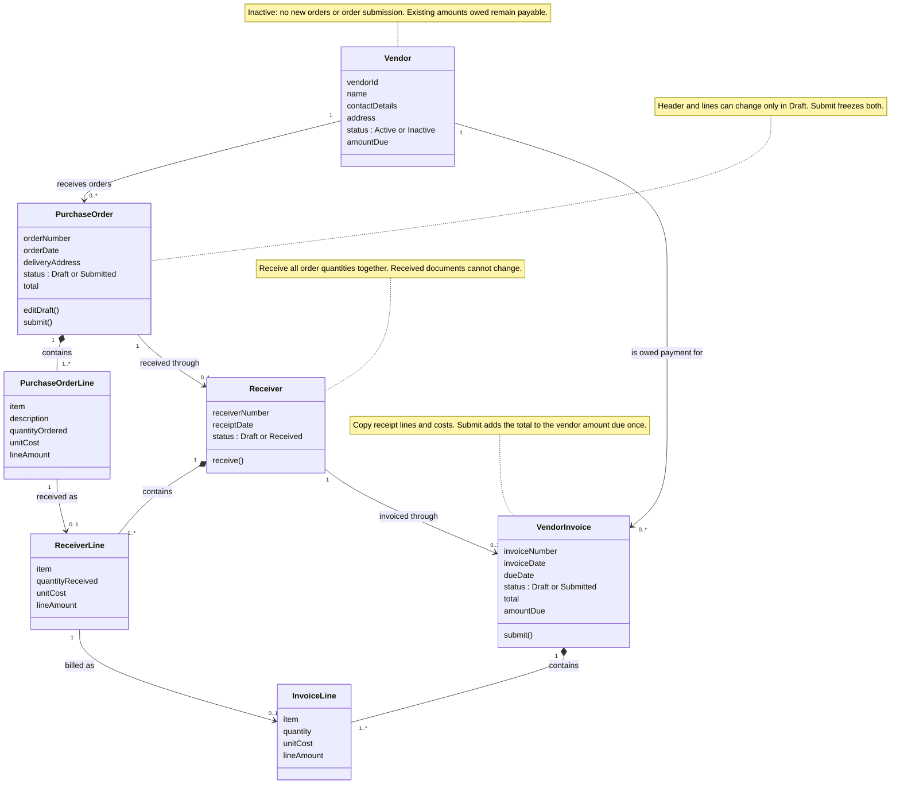
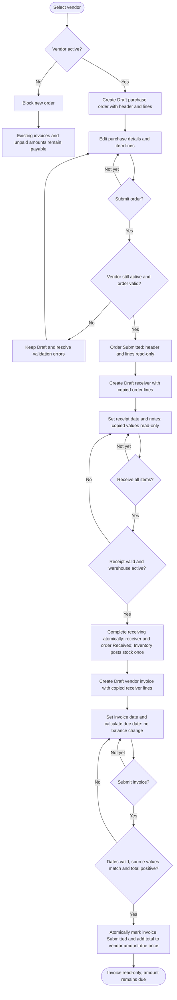

# Simple purchasing class diagram

A purchase order contains the purchase header details and its item lines. A receiver records what arrived from the vendor. A vendor invoice records the amount owed for that receipt.

- **Vendor:** Deactivation blocks new orders and order submission. It preserves existing orders, invoices and outstanding amounts. An existing receipt can still be invoiced for an inactive vendor; any amount owed remains payable.
- **Purchase order:** The order class is the document header; purchase order lines hold the items. Only Draft orders and their lines can be edited or deleted. Submit requires an active vendor and makes the document read-only.
- **Receiver:** Created from a submitted order. It records all received items and full quantities through receiver lines. A Draft receiver has no stock effect; Receive completes it once.
- **Vendor invoice:** Created from a received receiver. Vendor, items, quantities and costs are copied from the receipt. Only the invoice date is editable in Draft. Submit freezes the invoice and increases the vendor balance once. Draft invoices add nothing to the balance.

Each order has at most one receiver, and each receiver has at most one invoice, including Draft documents. Every document contains at least one line. A line belongs to exactly one document.

This simplified diagram uses **Submitted** for orders and invoices as requested. The detailed [purchasing design](purchasing-design.md) calls that state **Pending** and additionally marks an order **Received** when receiving completes. Payment processing is outside this diagram; making a vendor inactive never clears an unpaid balance.

## Purchasing flow diagram

Vendor deactivation after order submission does not clear existing obligations or block invoicing an existing receipt. Draft receivers have no stock effect, and Draft invoices have no balance effect. Repeated Receive or invoice Submit must not add stock or vendor debt again. Receiving is full quantity only; copied receiver and invoice lines cannot be edited.

Only eligible sources without an existing child, including a Draft, can create the next document. Deleting an eligible Draft releases its source for a replacement. All actions require permission and validation; failed posting leaves documents, stock and balances unchanged. Order and invoice **Submitted** use the simplified terminology above; completed receiving also marks the order **Received**, as in the detailed design.
