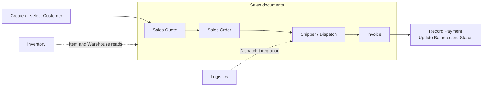
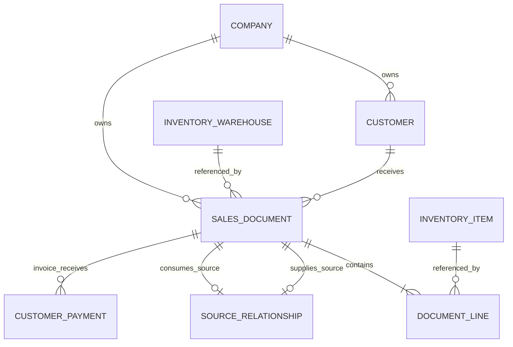
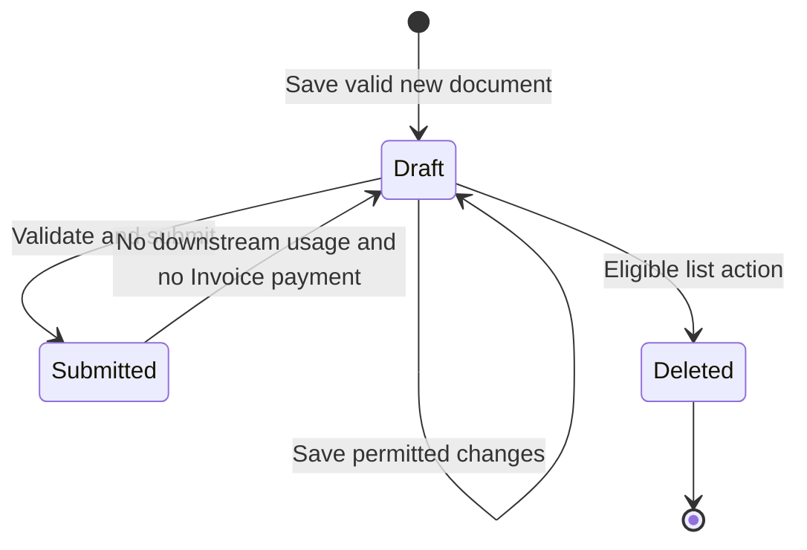
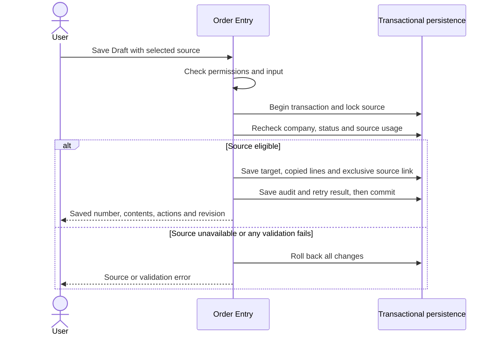
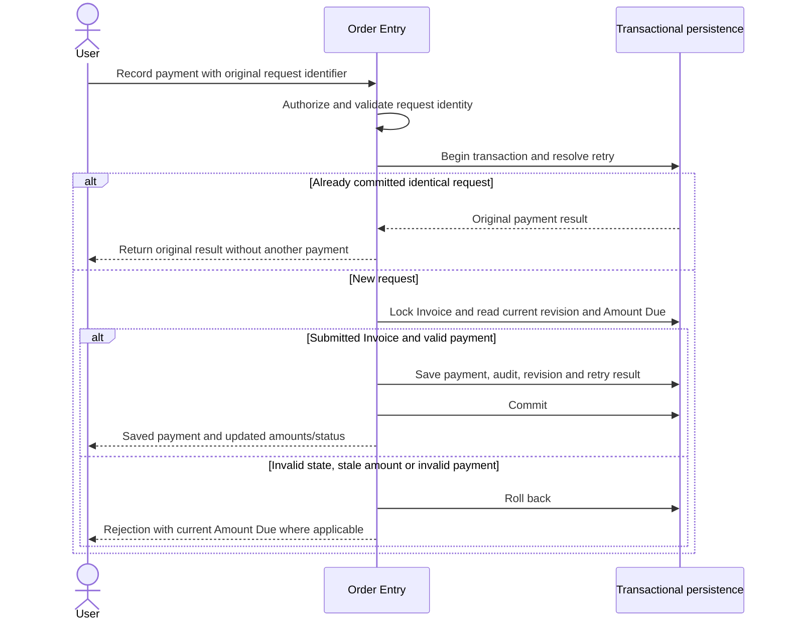

# Sales and Order Entry Design Document

**Permission decision - 20 November 2026:** Sales and Order Entry uses shared per-user grants. Non-admins have no business access until an admin assigns the corresponding object/operation grant; role labels provide no access. Admins retain all supported, active registered operations within their company. Services authorize before business access or replay. Company isolation, password-change restrictions and business rules still apply. Shipper submission additionally requires Logistics dispatch authorization; its adapter remains pending.

| Document information | Value |
| --- | --- |
| Status | Draft for PM and project guide review |
| Team | Sales and Order Entry, Team 3 |
| Developers | Kavya M and Sagar Khadka |
| QA | T C MOHAN BABU |
| PM | Supreeth |
| Project guide | Chirag |
| Automation guide | Brajesh |

## Introduction

Sales and Order Entry manages the sales process from Customer information and quotations through Orders, dispatch confirmation, invoicing and payment recording. It enables authorized users to maintain Customer details, prepare Sales Quotes and Sales Orders, create Shippers to confirm dispatch, issue Sales Invoices and record Customer payments.

Sales documents can be linked to their preceding documents to carry forward Customer details, Warehouse, item lines and other applicable business information. For example, a Sales Order can be created from a Sales Quote, a Shipper from a Sales Order and an Invoice from a Shipper. Orders, Shippers and Invoices can also be created independently when no source document is required.

Each document follows a controlled Draft and Submitted workflow. Users can prepare and update Drafts, while submission protects the saved business details from direct changes. The system validates Customer and item references, quantities, prices, dates and permissions, and calculates line amounts and document totals consistently.

For Submitted Invoices, the system tracks payments, remaining Amount Due and the total amount each Customer owes. It preserves document history and source relationships, prevents duplicate payment effects and ensures that rejected operations leave saved business data unchanged. Together, these controls provide an accurate and traceable view of sales transactions and outstanding Customer amounts.

## Overall Sales and Order Entry Flow

This shows the typical sales journey; Orders, Shippers and Invoices can also be created independently. Each sales document follows Draft/Submitted states. Dashed arrows show Inventory reference reads and Logistics integration responsibilities. A Submitted Invoice starts Unpaid; recording a valid received amount updates the outstanding balance and displays Partially Paid or Fully Paid. Payment entry records money received outside the application.

## Requirements and Stories

### Requirement Traceability

| Story | Business requirement | Design coverage |
| --- | --- |  --- |
| API-01 | Enforce permissions, company boundaries, complete validation and controlled document transitions | Permissions, document lifecycle, validations, security and transaction protection |
| API-02 | Create, list, read, update and deactivate/reactivate Customers; derive outstanding balance | Customer management, Customer fields and balance examples |
| API-03 | Manage Quotes and permit an eligible Submitted Quote as an optional Order source | Common document behavior, lines, sources and Quote details |
| API-04 | Manage standalone or Quote-linked Orders using Draft/Submitted states | Common document behavior, lines, sources and Order details |
| API-05 | Manage standalone or Order-linked Shippers; authorize dispatch confirmation | Shipper details, source protection and Logistics dependency |
| API-06 | Manage standalone or Shipper-linked Invoices and their balance contribution | Invoice lifecycle, amounts and return restrictions |
| API-07 | Record and read partial/full payments safely against current Amount Due |Payment flow, history, retries and concurrent payment protection |
| Cross-story | Expose saved numbers, totals, actions and revisions; combine document filters |UX and API behavior |

### Business Invariants

- Document status is Draft or Submitted for every document type.
- New unsaved documents cannot be submitted directly; a saved Draft must exist first.
- Every saved document has at least one valid line and one Warehouse shared by all lines.
- Customer, Item, Warehouse, document, source and payment references remain within the authenticated company.
- A source supports at most one full downstream document. A downstream Draft counts as usage.
- Submitted business fields are immutable until an eligible return to Draft.
- A retained source link continues to lock inherited fields even after return to Draft.
- Calculated totals, balances and payment statuses are never user-editable.
- Payments cannot exceed the current Amount Due, and a committed payment cannot be edited or deleted.
- A failed action cannot leave partial document, source, status or payment effects.

## Scope

| Component | Included | Business impact |
| --- | --- | --- |
| Product interfaces | Yes | Customer and document APIs/UI, lookups, workflow actions and payment history |
| Services and business logic | Yes | Validation, source copying, state changes, calculations and payment recording |
| Shared business logic | Limited | Reuse authorization, revisions, transaction handling, audit and replay conventions; review required extensions |
| Internal interfaces | Yes | Inventory reference reads and Logistics dispatch integration agreement |
| Setup | Limited | Register shared route capabilities and apply separately reviewed migrations |
| Master data | Yes | Customer metadata; Item and Warehouse remain Inventory-owned |
| Transactions | Yes | Quotes, Orders, Shippers, Invoices and Customer payments |
| Transient data | Limited | Unsaved forms and source previews confer no persisted source claim |
| Background processing | No | No background posting, recurring invoicing or automatic payment collection |
| External I/O | No | No bank gateway, import/export or third-party tax integration |
| Document printing | No | Printable invoices, PDFs and email delivery are outside this release |
| Reports | No | Operational lists and derived balances are included; a reporting subsystem is excluded |
| Metrics and tracing | Limited | Safe action/error correlation and diagnosis of failed document/payment operations |

Approvals, taxes, retainage, discounts, stock allocation/movements, delivery tracking, split shipments/invoices, returns, credits, refunds and opening balances are outside scope. Payment Terms do not introduce credit approval or overdue-payment automation.

## Domain Model

### Business Objects

| Object | Responsibility |
| --- | --- |
| Customer | Company-specific identity, contact/address details, active status and default Payment Terms |
| Sales document | Common identity, type, Customer, Warehouse, business dates, status, total and revision |
| Document line | Stable identity, display order, Item reference, description snapshot, Quantity, Unit Price and Line Amount |
| Source relationship | Traceable exclusive link from a downstream document to the immediately preceding document type |
| Customer payment | Immutable payment number, Invoice reference, amount, date, business reference and recording history |

The Invoice subtype alone accepts payments. Quotes cannot consume a source. Orders consume Quotes, Shippers consume Orders, and Invoices consume Shippers. The diagram describes business relationships, not physical table names or an approved schema.

Document and line system IDs remain stable. Business document/payment numbers are generated, read-only, unique in the agreed company/type namespace, at most 20 characters and never reused, including after Draft deletion. Gaps in numbering are acceptable. These numbering details are proposed design choices for guide review.

Inherited descriptions, addresses, terms and prices are preserved as document values. Editing Customer or Inventory metadata does not silently rewrite existing document history. Customer outstanding balance is derived from Submitted Invoices and their recorded payments rather than maintained as an independently editable amount.

## User Experience and Permissions

### Screens and Actions

| Screen | Required behavior |
| --- | --- |
| Customer list/detail | Search Customer ID/Name; filter Active/Inactive; create, read, update and change active status as permitted |
| All Documents | Combine type, Customer, date range, Warehouse, document status and Invoice payment-status filters; show eligible document Delete action here |
| New document | Choose type, enter standalone details or select a source, then Save as Draft |
| Draft document | Save Changes, Save as Submitted, and edit only permitted fields |
| Submitted document | Read business values; offer Move to Draft only when eligible |
| Source selection | Show eligible same-company Submitted predecessors that the user can read; preview inherited values |
| Invoice payment entry | Show current total, paid, due and payment status; record a new payment only for an eligible Submitted Invoice |
| Payment history | Read-only payment number, date, reference, amount and recording information |

Source replacement/clearing requires confirmation before replacing inherited details. An invalid save retains the persisted version and lets the user correct their input. An uncertain timeout requires retrying the original request identifier and payload before starting a new action.

Invoice payment-status filters return Submitted Invoices only. An incompatible document-type filter combined with a payment-status filter produces no matching rows. Invalid date ranges are rejected. List pagination and deterministic ordering will follow the foundation API conventions.

### Access rule

Every Sales operation requires its registered object/operation permission, including reads, lookups and mutations. Use shared Authorization through SalesPermissions before reading business data or replaying a result. Non-admins without the matching per-user grant receive HTTP 403; role labels grant no access. Authentication failures receive HTTP 401 through the shared bearer flow.

Admins remain subject to company isolation, password-change restrictions, versions and all business conditions. Customer deletion and payment editing/deletion remain unsupported. Shipper submission requires the sales.shippers:submit permission, Carrier validation and the Logistics dispatch authorization defined by the API-05 contract; the real adapter is pending implementation. Route and service checks use the same shared permission registrations. API-01 has no separate endpoint or request/response contract.

## Detailed Business Design(every module in detail)

### Customer Management

Customer creation defaults Status to Active and Payment Terms to Net 30. Customer ID is unique within the company and immutable after creation. Users can update other metadata and deactivate/reactivate the Customer with authorization.

Inactive Customers disappear from new selections. Historical document references remain readable, and payments against existing Submitted Invoices remain allowed after Customer deactivation. Active-reference validation on Draft save/submission follows the rule in the validation section; no existing Submitted Invoice is invalidated by deactivation.

| Field | Required | Limit or behavior |
| --- | --- | --- |
| Customer ID | Yes | 20 characters; letters, numbers and hyphens; immutable |
| Customer Name | Yes | 100 characters |
| Status | Yes | Active/Inactive; default Active |
| Contact Name | No | 100 characters |
| Email Address | No | 254 characters; validate format if provided |
| Phone Number | No | 25 characters; digits, spaces, plus, hyphen and parentheses |
| Billing Address Line 1 | Yes | 150 characters |
| Billing Address Line 2 | No | 150 characters |
| City | Yes | 80 characters |
| State / Province | No | 80 characters |
| Postal Code | No | 20 characters; preserve leading zeros |
| Country | Yes | Free text, 80 characters; no country-code list |
| Payment Terms | Yes | Due on receipt, Net 15, Net 30 |
| Notes | No | 500 characters |
| Amount Customer Owes Us | Calculated | Up to 16 whole digits and 2 decimals; default 0.00 |

Customer balance equals the sum of Amount Due across that Customer's Submitted Invoices. Draft Invoices contribute nothing. Each payment reduces the outstanding amount by its recorded value. No opening-balance, credit or refund adjustment is introduced.

### Common Document Fields

| Field | Required | Limit or behavior |
| --- | --- | --- |
| Document number | Generated | Type-specific label; maximum 20 characters; read-only |
| Customer | Yes | Active company Customer; Customer ID reference up to 20 characters |
| Warehouse | Yes | Active Inventory Warehouse available to company; reference up to 20 characters |
| Document date | Yes | YYYY-MM-DD; default current business date |
| Document Status | Generated | Draft/Submitted; changed only by actions |
| Notes | No | 500 characters |
| Item | Per line | Active Inventory Item available to company; Item Code up to 30 characters |
| Description | Per line | Required, 200 characters; initialized from Item description |
| Quantity | Per line | Greater than zero; maximum 9 whole digits and 3 decimals |
| Unit Price | Per line | Zero or greater; maximum 10 whole digits and 2 decimals |
| Line Amount | Calculated | Quantity multiplied by Unit Price, rounded half up to 2 decimals |
| Document Total | Calculated | Sum of rounded Line Amounts; maximum 16 whole digits and 2 decimals |

Trim free text before checking required values and character limits. Validate decimal precision and numeric capacity without truncation. Monetary and quantity processing uses exact decimal values; the proposed API represents them as decimal strings to preserve precision.

### Document Lifecycle

Deleted is the end of an eligible Draft's lifecycle, not a third stored document status. A failed save/transition leaves the current state unchanged. The Invoice payment condition applies only to Invoices.

| Action | Preconditions | Successful result | Rejection behavior |
| --- | --- | --- | --- |
| Create Draft | create permission; valid complete header/lines; eligible source if selected | Numbered Draft, saved lines, initial revision and source claim if linked | Save no document, lines or claim |
| Save Changes | update permission; current Draft revision; valid complete contents | Replace intended editable contents and recalculate amounts atomically | Preserve saved contents and totals |
| Save as Submitted | Saved Draft; submit permission; complete validation and type-specific conditions | Submitted; Invoice payment status becomes Unpaid and outstanding contribution becomes visible | Remain Draft with no partial effects |
| Move to Draft | Submitted; return_to_draft permission; no downstream document; no Invoice payment | Draft; retain upstream link; clear Invoice payment status and remove balance contribution | Remain Submitted |
| Delete | delete permission; eligible Draft; no downstream reference | Remove eligible document/lines; release upstream claim; preserve audit and number non-reuse | Preserve document and references |

### Source Selection and Replacement

Quotes have no source. Orders optionally use a Submitted Quote, Shippers optionally use a Submitted Order, and Invoices optionally use a Submitted Shipper.

1. Offer only a readable, same-company Submitted predecessor that is not already used by another downstream document.
2. Preview the copied values. Preview does not reserve a source.
3. On saving, lock and recheck the source before claiming it. Save the target and its source relationship in the same transaction.
4. Copy Customer, Warehouse, all lines and applicable inherited address/Payment Terms. New target lines receive their own IDs while preserving source-line traceability.
5. Keep inherited fields read-only. Target-specific dates, Notes and shipping/invoice details remain governed by their own rules.
6. Recheck the retained relationship and eligibility at submission; the document's own claim does not count as competing usage.
7. Before submission, source changes/clearing require confirmation to replace inherited details. Revalidate the complete resulting Draft. Releasing the old claim and acquiring a new claim succeed together, or neither takes effect.
8. Deleting the downstream Draft releases its claim. Moving it to Draft retains the claim until its source is cleared/changed or the Draft is deleted.

For a linked document, inherited values must match the source. Do not permit manual additions, edits or omissions within copied lines. No partial copy, source reuse or split downstream processing is supported.

### Line Entry and Calculations

Document create/read/update operations carry lines within the parent document. A write supplies the complete intended line collection. New lines omit their saved line identity; existing lines retain it. Omitting a saved line removes it only on an editable standalone Draft. Reordering changes display order without changing saved line identity.

Repeated Items on distinct lines are allowed, including different descriptions or prices. Repeated saved line IDs or line IDs from another document are rejected. Every line derives Warehouse from its header. At least one valid line must remain.

Calculate each Line Amount independently using half-up rounding to two decimal places, then sum those rounded amounts. Reject calculated values beyond the 16-whole-digit, 2-decimal capacity. Status, source relationships and Customer balances do not change merely because a Draft's lines change.

| Example | Expected amounts |
| --- | --- |
| Quantity 2 at 125.50; Quantity 1.250 at 10.00 | 251.00 + 12.50 = 263.50 |
| Change first Quantity to 3 | 376.50 + 12.50 = 389.00 |
| Remove second line | Total 376.50 |
| Remove remaining line | Reject; keep the saved line and total |
| Quantity 0.005 at 1.00 on each of two lines | Each rounds to 0.01; total 0.02 |
| Valid first line and invalid second line | Reject entire write; persist neither partial edits nor recalculated totals |

### Sales Quote and Sales Order

| Field | Quote | Order |
| --- | --- | --- |
| Document date | Quote Date; current business date by default | Order Date; current business date by default; on/after linked Quote Date |
| Valid Until | Optional; on/after Quote Date | Not applicable |
| Requested Delivery Date | Optional; on/after document date | Optional; on/after document date |
| Shipping Address | Required, 500 characters; default billing address; editable standalone | Required, 500 characters; inherit when linked, otherwise default billing address |
| Payment Terms | Required; default Customer terms | Required; inherit when linked, otherwise default Customer terms |
| Customer PO Number | Not applicable | Optional, 30 characters |
| Source | Not applicable | Optional Submitted Sales Quote Number, maximum 20 characters |

A Submitted Order becomes eligible as a Shipper source; submission does not allocate stock or create Pending/Shipped/Completed states. A Quote cannot return to Draft while any Order references it. An Order cannot return to Draft while any Shipper references it. A downstream Draft blocks these actions just as a Submitted downstream document does.

### Shipper

Shipment Date is required, cannot be in the future and must be on/after the linked Order Date. Shipping Address is required, maximum 500 characters, defaulted from the source or Customer and editable only when standalone. Carrier is maximum 100 characters and required on submission. Tracking Number is optional, maximum 50 characters.

Shipper submission requires the sales.shippers:submit permission, a valid Carrier and Logistics dispatch authorization. Its action label is Save as Submitted. Submitted means dispatch confirmed; the linked Order remains Submitted. OE performs no stock deduction or delivery posting.

The approved API-06 contract does not add Payment Terms to Shipper. Invoice terms default from a source when it supplies them, otherwise from Customer; the current Shipper contract supplies none, so Customer terms are used. Invoice terms remain editable on Draft, including source-linked Invoices.

A Shipper cannot return to Draft while any Invoice references it, including a Draft Invoice.

### Sales Invoice

Invoice Date is required and on/after a linked Shipment Date. Payment Terms default from the source or Customer; the current Shipper has no terms, so default from Customer and permit Draft editing. Under the approved API-06 plan, Due Date defaults to Invoice Date plus 0/15/30 calendar days and cannot precede Invoice Date. An explicit valid Due Date is allowed. If Invoice Date or Payment Terms changes on PATCH and Due Date is omitted, recompute it; otherwise retain the explicit valid date. Draft Amount Due equals Invoice Total minus Total Paid but has no Customer-balance contribution.

1. Save as Draft with no populated payment status. No payment entry is available, and it contributes nothing to Customer balance.
2. Submit only if Invoice Total is greater than zero. In the same transaction, change status to Submitted and establish the Unpaid state. The Invoice contributes its Amount Due once to the derived Customer balance.
3. Return to Draft only if no downstream reference and no recorded payment exists. Remove its outstanding contribution and clear payment status atomically. Retain its upstream source link if one exists.
4. Resubmission re-establishes the contribution once. It does not create a second Invoice or double-count its amount.
5. Payment recording leaves document status Submitted. Paid is a payment status, never a document status.

### Customer Payments

| Field | Rule |
| --- | --- |
| Invoice Total | Read-only sum of saved Invoice lines |
| Total Paid | Read-only sum of recorded payments; starts at 0.00 |
| Amount Due | Invoice Total minus Total Paid |
| Payment Status | Unpaid, Partially Paid or Paid; populated only for Submitted Invoices |
| Payment Amount | Required; greater than zero; at most current Amount Due; maximum 16 whole digits and 2 decimals |
| Payment Date | Required; on/after Invoice Date and not in the future |
| Payment Reference | Required; trimmed text, maximum 50 characters |
| Payment Number | Generated read-only identifier, maximum 20 characters |

Authorize the user and check safe retry identity before executing a new payment. Lock the Invoice, re-read its status and current due, validate the payment, then save the payment, revision, audit and retry result atomically. Derive Total Paid, Amount Due, payment status and Customer balance from the committed state. An inactive Customer does not prevent payment against an existing Submitted Invoice.

| Invoice Total | New payment | Total Paid | Amount Due | Resulting payment status |
| --- | --- | --- | --- | --- |
| 1,000.00 | None | 0.00 | 1,000.00 | Unpaid |
| 1,000.00 | 300.00 | 300.00 | 700.00 | Partially Paid |
| 1,000.00 | Attempt 800.00 | 300.00 | 700.00 | Rejected; no change |
| 1,000.00 | 700.00 | 1,000.00 | 0.00 | Paid |

Customer balance combines all that Customer's Submitted unpaid/partly paid Invoices. For example, an additional Submitted Invoice owing 200.00 means a 700.00 due on the first Invoice produces a Customer balance of 900.00.

## Validations and Restrictions

### General and Customer Validation

| Condition | User-facing message |
| --- | --- |
| Missing required field | Enter {Field label}. |
| Text too long | {Field label} must be {limit} characters or fewer. |
| Duplicate Customer ID | Customer ID already exists. Enter a unique ID. |
| Changing saved Customer ID | Customer ID cannot be changed after creation. |
| Invalid Customer ID characters | Customer ID may contain only letters, numbers and hyphens. |
| Invalid optional email/phone | Enter a valid Email Address. / Enter a valid Phone Number. |
| Invalid Customer status/terms | Select a valid Status. / Select valid Payment Terms. |
| Caller supplies editable Customer balance | Amount Customer Owes Us is calculated and cannot be edited. |
| Invalid reference selection | Select a valid {Field label} available to your company. |
| Inactive selected reference | Selected {Customer / Item / Warehouse} is inactive. Select an active record. |
| Invalid date format | Enter a valid {Date label} in YYYY-MM-DD format. |
| Invalid date sequence | {Date label} must be on or after {Earlier date label}. |
| Future Shipment/Payment Date | {Date label} cannot be in the future. |
| Invalid filter date range | From Date must be on or before To Date. |
| Missing permission | You do not have permission to perform this action. |

New selections require active references. The proposed Draft-save/submission policy also revalidates current active references, including inherited references; deactivated records remain readable historically. The PM should confirm treatment of references deactivated after a source was Submitted, as recorded in the decision log.

### Lines and Document Actions

| Condition | User-facing message |
| --- | --- |
| Missing/empty intended lines | Add at least one item line. |
| Unknown/foreign saved line ID | Line {n}: Select a valid line belonging to this document. |
| Duplicate saved line ID | Line {n}: Duplicate line identifier. |
| Missing/inactive/unavailable Item | Line {n}: Select an active Item available to your company. |
| Blank Description | Line {n}: Enter Description. |
| Description too long | Line {n}: Description must be 200 characters or fewer. |
| Invalid Quantity | Line {n}: Enter Quantity greater than 0, with up to 9 whole digits and 3 decimal places. |
| Invalid Unit Price | Line {n}: Enter Unit Price of 0 or more, with up to 10 whole digits and 2 decimal places. |
| Line Warehouse mismatch | Line {n}: Warehouse must match the document Warehouse. |
| Caller edits calculated Line Amount | Line {n}: Line Amount is calculated and cannot be edited. |
| Caller edits Document Total | Document Total is calculated and cannot be edited. |
| Calculated amount overflow | {Line Amount / Document Total} exceeds the allowed numeric limit. |
| Edit inherited lines | Source-linked lines cannot be added, changed or removed. |
| Edit Submitted document | Only Draft documents can be edited. |
| Stale document revision | This document has changed. Refresh and try again. |
| Direct status update | Use the available action to change Document Status. |
| Source unavailable | Selected source is no longer available. Refresh and select another source, or leave Source blank. |
| Copied value mismatch | {Field label} must match the source document. |
| Downstream usage blocks return | Cannot move to Draft: this document is used as a source by {Document number}. |
| Payment blocks Invoice return | Cannot move to Draft: a payment has been recorded for this Invoice. |
| Ineligible document deletion | Only Draft documents with no downstream documents can be deleted. |
| Carrier absent at submission | Enter Carrier before submitting the Shipper. |
| Nonpositive Invoice Total at submission | Invoice Total must be greater than 0. |

Error line numbers refer to display order. Rejections identify the affected field or action and preserve saved data. The more specific v6.1 line precision messages above take precedence over shorter general quantity/price wording elsewhere in the PDF.

### Payment Validation

| Condition | User-facing message |
| --- | --- |
| Payment against Draft Invoice | Submit the Invoice before recording a payment. |
| Missing/nonnumeric amount | Enter Payment Amount. / Enter a valid Payment Amount. |
| Zero/negative amount | Payment Amount must be greater than 0. |
| Excess decimal places | Payment Amount can have at most 2 decimal places. |
| Amount exceeds current due | Payment Amount cannot exceed Amount Due ({current amount due}). |
| Invoice already Paid | This Invoice is fully paid. No further payment can be recorded. |
| Concurrent change | Amount Due has changed to {current amount due}. Review the amount and try again. |
| Missing/overlength reference | Enter Payment Reference. / Payment Reference must be 50 characters or fewer. |
| Date before Invoice | Payment Date must be on or after Invoice Date. |
| Future payment date | Payment Date cannot be in the future. |

## Transaction Protection and Failure Handling

| Scenario | Protection and expected outcome |
| --- | --- |
| Invalid later line | Roll back the complete action, including earlier line changes, source changes, totals, audit and retry result |
| Two users edit one Draft | Recheck the saved revision under lock; reject the stale write without overwriting newer lines |
| Two targets select one source | Serialize source claims and enforce exclusive usage; one wins, the other saves no target/claim |
| Source claim races return to Draft | Lock and recheck the source state/usage so both actions cannot commit an inconsistent result |
| Source replacement fails | Retain the original document and original source relationship |
| Invoice submit/return races payment | Serialize on Invoice state; payment cannot coexist with a successful return to Draft |
| Two payments compete | Recheck current Amount Due inside the payment transaction; never allow negative due |
| Request times out after commit | Same identifier and unchanged payload return the original committed result |
| Same identifier has changed payload | Reject as a request conflict; do not overwrite the original result |
| Reference service unavailable | Reject the affected operation with an actionable failure; do not silently substitute sample data |
| Persistence fails | Roll back business changes; return a safe correlated error without database details |

Acquire locks in one reviewed deterministic order, including sorted old/new source identities during replacement, and recheck business facts after locks. All participating services use the same transaction; only its owner commits. Safe retries authorize first and resolve an identical committed request before applying today's revision check.

The same request identifier prevents duplicate payment effects. Payment Reference is a business description, not an assumed globally unique bank transaction ID. A deliberately new identifier represents a new payment request, still bounded by current due. The UI must retain the identifier across an uncertain retry and require a deliberate new payment action before creating another.

## Dependencies and Impact on Other Modules

| Area | Dependency or change | Required coordination |
| --- | --- | --- |
| Inventory | Read active Item/Warehouse choices and validate references; no OE CRUD or stock write | Agree reference fields, company visibility and unavailable-service behavior |
| Logistics | Shipper submission confirms dispatch | Agree dispatch integration responsibilities; avoid duplicate dispatch/stock responsibilities |
| Shared permissions | Register Customers, document types and payment capabilities | Shared object/action definitions; routes and services enforce per-user grants |
| Shared action/audit handling | Reuse retry/audit concepts without note-specific assumptions | Existing ActionExecutor has a trainee-role check and note-specific event type; review before reuse |
| API boundary | Complete line collections, decimal strings, safe errors and revisions | Current 8 KiB body limit needs review against realistic document sizes before contract approval |
| Database tooling | Independently installable OE migrations and later real-reference links | CLI supports migrate --module=sales, running Shared before Sales; verify the target schema and use the reviewed Oracle DDL recovery procedure |
| Existing Sales guidance | Older allocation/fulfillment scope and diagrams conflict with v6.1 | Reconcile team brief, shared-contract references and diagrams before implementation |
| Customer balance consumers | Outstanding amount follows Submitted Invoices less payments | Reuse the same authoritative calculation rather than a second writable balance |
| QA and UI | Same business rules/errors across API and later UI | Formal test plan after approvals; UI repeats accepted API business scenarios |

Domain migrations must remain separate from applied foundation migrations. Cross-module foreign keys are added only when the real referenced Inventory tables exist, with separate integration review. Neither mock reference data nor local tests prove real Inventory integration or Oracle locking behavior.
