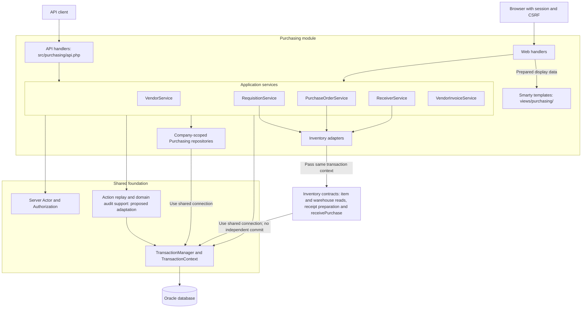
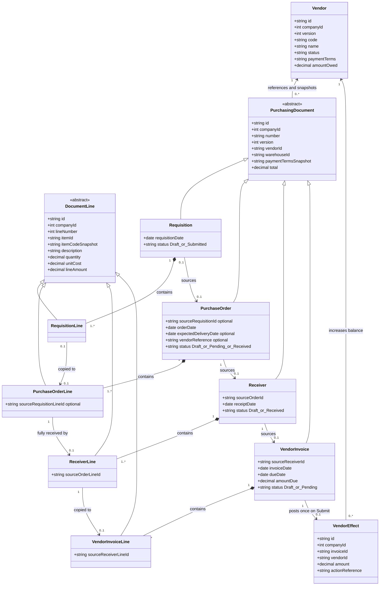
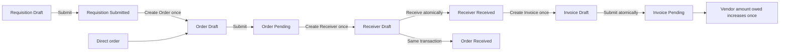
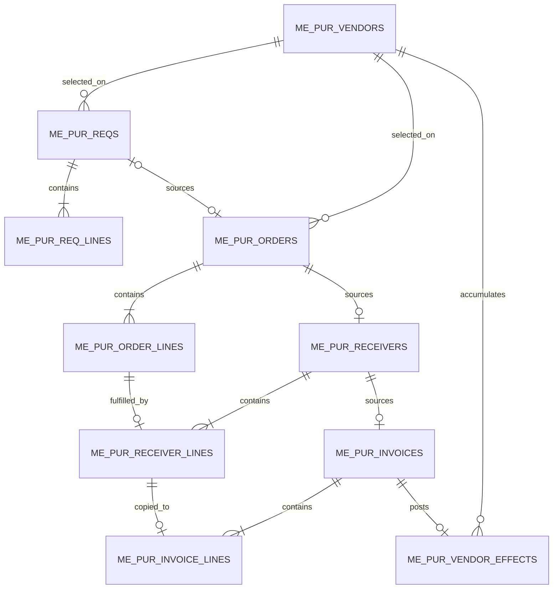
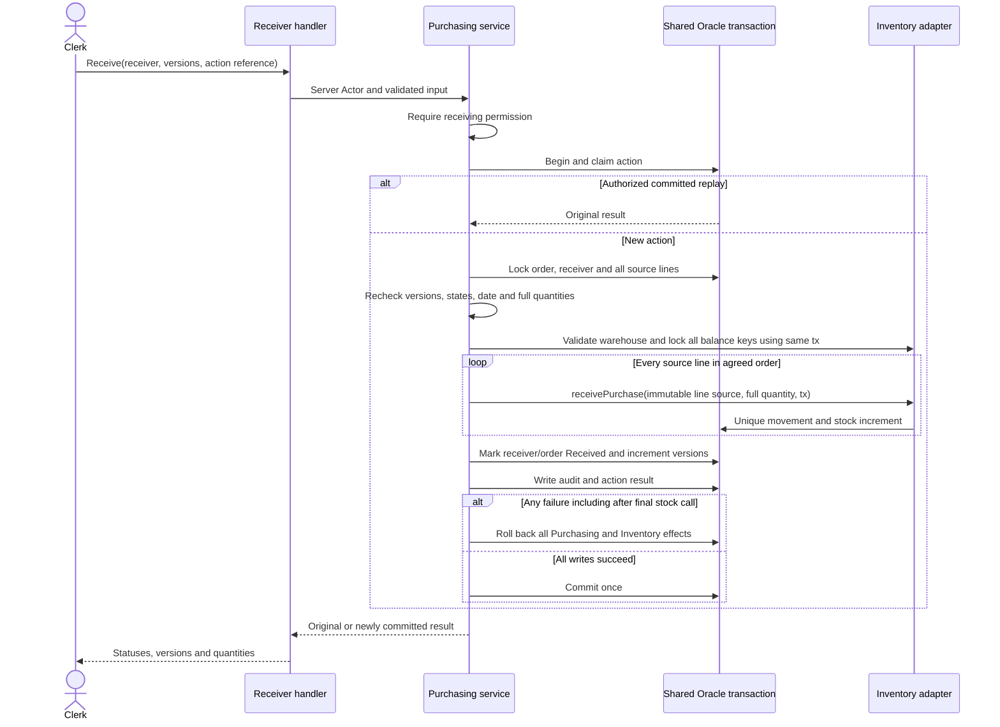

# Purchasing API design through vendor invoice

**Status:** Draft for design review  
**Date:** 17 November 2026  
**Target:** Purchasing API delivery v4.0, APIs in week 1 and UI in week 2  
**Review participants:** Purchasing developer and QA, PM Nithya, project guide Karthik, automation guide Brajesh, Inventory and foundation reviewers

Purchasing maintains vendors and carries a purchase through optional requisition, order, full receiving and vendor invoice. Every workflow action is authorized, company scoped, version checked and atomic. Inventory owns items, warehouses and stock. Invoice submission increases the amount owed to a vendor exactly once.

## 1 Scope and source reconciliation

Business reference: [Purchasing API delivery v4.0](../Purchasing_PO_API_Through_Vendor_Invoice%20%281%29.pdf), dated 17 November 2026. The [Team 2 brief](team-2-purchasing.md) defines review deliverables and engineering controls but describes a different baseline.

**Proposed assumption:** use the newer PDF for business behavior and retain compatible repository engineering controls. This is a review proposal, not an approved change to the project baseline. Resolve the following differences before domain migrations or implementation.

| Area | Existing Team 2 baseline | Proposed PDF v4 target |
| --- | --- | --- |
| Staffing | 1 developer + 1 QA | 2 developers + 1 QA |
| Documents | Supplier, PO, approval versions, posted receipt | Vendor, requisition, PO, draft/received receiver, vendor invoice |
| Order lifecycle | Draft -> Submitted -> Approved -> Closed | Draft -> Pending -> Received |
| Approval | Independent approver, rejection/revision history | Deferred; Pending means ready for receiving |
| Quantity | Positive whole units | Positive decimal, 9 whole digits + 3 decimal places |
| Warehouse | Shared baseline single warehouse | One Inventory-owned warehouse per document |
| Dates | Required date mandatory | Order Date required; Expected Delivery Date optional |
| Removal | Whole unreceived PO cancellation with reason | Delete saved Draft with no downstream documents |
| Invoice | Excluded | Draft -> Pending, vendor balance posting |
| Delivery | Principal path with doubles Day 4 | APIs week 1, UI week 2 |

The README and Inventory contracts also assume whole units and the original workflow. PDF adoption therefore requires a reviewed cross-team scope change. Never round decimal quantities to fit an integer adapter.

Included stories are API-01 permissions; API-02 vendor maintenance; API-03 requisitions and conversion; API-04 direct/linked orders; API-05 full receiving; API-06 vendor invoices. Include source eligibility, draft deletion/source release, unique numbers, snapshots, audit, exact totals, safe retries and concurrent-request protection.

Approvals, partial receipts, returns, payments, tax, discounts, valuation, accounting journals and Inventory administration are excluded. Pending invoice means unpaid. Amount Due remains Total because payments are excluded.

## 2 Architecture and implementation boundaries

Use the existing PHP 8.4 modular monolith, Oracle OCI8, shared API framework and Smarty. Internal module calls share one connection and transaction; do not use HTTP between modules.

### Component diagram

Arrows show calls or dependencies. Purchasing services enforce business rules for both entry points; all persistence and Inventory effects participate in the same transaction.



| Component | Responsibility |
| --- | --- |
| `src/purchasing/api.php` | Register routes with explicit permission metadata; parse requests and return service results |
| `VendorService` | Vendor validation, identity, activation and read-only balance |
| `RequisitionService` | Draft maintenance, Submit and Create Order |
| `PurchaseOrderService` | Direct/linked drafts and Submit to Pending |
| `ReceiverService` | Source copying, receiver drafts and full Receive orchestration |
| `VendorInvoiceService` | Source copying, due dates and invoice/balance posting |
| Repositories | Bound SQL scoped by Actor company through connection/transaction context |
| Inventory adapters | Item/warehouse reads and stock receipt; no independent commit |
| `views/purchasing/` | Prepared display data only; no SQL or authorization |

These domain classes/interfaces are proposed, not existing implementations. UI and REST share the same services. Use lowercase folders, `MiniErp\purchasing` namespaces, Smarty templates, mounted URLs through `WebPath::url()`/`appUrl()`, and the existing safe error envelope.

### Class diagram

This conceptual domain model complements the service responsibilities above and the physical ERD in section 4. The abstract classes collect shared fields for readability; they do not mandate PHP inheritance. Attributes are representative, and `decimal` denotes exact decimal values carried as canonical strings at API boundaries.



Cardinalities describe live saved documents, including Draft children that reserve their source. A direct order has no source requisition; every receiver and invoice has exactly one source. Draft deletion releases the source link. A vendor effect exists only after invoice Submit and is immutable. All references include company; copied source-line membership is constrained as described in section 4. Items and warehouses remain Inventory-owned references rather than Purchasing aggregates. Workflow operations belong to the services above; document status and calculated amounts cannot be set directly by clients.

**Foundation adaptation:** reuse `TransactionManager`/`TransactionContext`. Current `ActionExecutor` requires the unrelated `trainee` role and always audits `NEUTRAL_NOTE_UPDATE`. Review a compatible extension for registered business permissions and real event types while preserving actor/company replay checks and canonical payload hashing. Do not reuse its note-specific event semantics unchanged.

Current `public/openapi.yaml` contains authentication drafts, not Purchasing routes; it also has duplicate login operation IDs and an `/auth/test` entry. The implementation PR should align authentication documentation with the framework and add reviewed Purchasing operations with unique operation IDs.

## 3 Workflows and invariants



| Document | Draft editing | Transition and effect |
| --- | --- | --- |
| Requisition | Vendor, warehouse, date, terms, address, notes and lines | Submit -> Submitted; freeze contents |
| Order | Dates, vendor reference, address, terms, notes and lines; direct order vendor/warehouse | Submit -> Pending; freeze contents |
| Receiver | Receipt Date and Notes only | Receive -> receiver/order Received and Inventory effects |
| Invoice | Invoice Date only | Submit -> Pending and vendor amount owed increase |

For linked orders, source/vendor/warehouse are immutable. Proposed policy: initially copy all other source fields and lines, then permit ordinary Draft edits to address/terms/notes/lines. Confirm this policy at review because the PDF does not define every inherited field's editability. Receiver/invoice source values are always read-only.

Source statuses do not change on downstream draft creation or deletion. A requisition remains Submitted after conversion; an order remains Pending until Receive; a receiver remains Received during invoicing. A Draft child reserves its source immediately. Eligibility means the right status and no live downstream record, including a Draft.

Only saved Draft transactions without downstream documents may be deleted. Vendor records are deactivated. Draft deletion removes the child and releases its source atomically without changing source status, stock or vendor balance. Preserve its number reservation and audit. No direct status edits, posted edits or posted deletes are allowed.

Retain the Team 2 rule of unique items per requisition/order as a **proposed** rule; the PDF only says one item per line. Confirm duplicate-item policy. Line IDs remain stable during Draft updates; new/replaced lines receive new IDs.

## 4 Data model and dictionary

Every business table has mandatory `COMPANY_ID`, with composite keys/FKs preventing cross-company references. All application-defined Oracle objects/constraints/indexes begin `ME_`.



The ERD shows live documents. Persist a header and at least one valid line together. Shared company/user/action/audit and Inventory references are external.

### Storage conventions

| Field | Proposed Oracle type and rule |
| --- | --- |
| Internal and peer ID | `VARCHAR2(40)`; freeze peer ID types before migration |
| Company | `NUMBER(10)`, references shared company |
| Version | `NUMBER(10)`, positive, starts at 1, increment each accepted mutation |
| Text | `VARCHAR2(n CHAR)` using limits below |
| Business date | `DATE`, date only; strict calendar validation |
| Actor/time | Company/user compound FK; `TIMESTAMP WITH TIME ZONE` |
| Quantity | `NUMBER(12,3)`, >0, max `999999999.999` |
| Unit cost | `NUMBER(12,2)`, >=0, max `9999999999.99` |
| Amount | `NUMBER(18,2)`, >=0, max `9999999999999999.99` |
| Status and terms | Explicit allowed-value checks |

Validate precision before SQL; Oracle assignment rounding must not accept excess input precision. Use canonical decimal strings and reviewed exact arithmetic, never PHP/JS floats for authoritative values. Current Composer dependencies do not provide a decimal library; choose a reviewed exact-decimal utility or dependency.

### Tables and constraints

All headers include ID, company, number, version, created/updated actor/time and workflow actor/time where applicable. References include company.

| Table | Principal fields and constraints |
| --- | --- |
| `ME_PUR_VENDORS` | Vendor code/name/status, contact/address fields, terms, notes, amount owed. Unique company/code; code immutable; balance default 0.00 |
| `ME_PUR_REQS` | Vendor/warehouse IDs and snapshots, requisition date, terms, delivery address, notes, total, Draft/Submitted |
| `ME_PUR_REQ_LINES` | Header ID, line ID/number, item ID/code snapshot, description, quantity/cost/amount; unique header/line number and proposed header/item |
| `ME_PUR_ORDERS` | Optional source requisition, vendor/warehouse snapshots, order/expected dates, vendor reference, terms/address/notes/total, Draft/Pending/Received; unique non-null company/source requisition |
| `ME_PUR_ORDER_LINES` | Header/line IDs, optional source requisition line, item/description snapshot, ordered quantity/cost/amount; line uniqueness as above |
| `ME_PUR_RECEIVERS` | Source order, vendor/warehouse/address/terms snapshots, receipt date, notes/total, Draft/Received; unique company/source order |
| `ME_PUR_RECEIVER_LINES` | Header/line IDs, source order line, copied item/description/quantity/cost/amount; unique company/source order line |
| `ME_PUR_INVOICES` | Source receiver, vendor/warehouse/terms snapshots, invoice/due dates, total/amount due, Draft/Pending; unique company/source receiver |
| `ME_PUR_INVOICE_LINES` | Header/line IDs, source receiver line, copied item/description/quantity/cost/amount; unique company/source receiver line |
| `ME_PUR_VENDOR_EFFECTS` | Immutable ID, vendor, invoice, positive amount, action reference, actor/time; unique company/invoice |
| `ME_PUR_NUMBERS` | Company, type, number, document ID, issued time; unique company/type/number; retained after deletion |

Compound FKs also ensure each copied source line belongs to the header's source document. Example: receiver line includes source order ID and references both (company, receiver, order) and (company, order, order line). Apply equivalent constraints to copied invoice/requisition lines.

Do not cascade deletions into source documents, Inventory movements, vendor effects, actions or audit. Purchasing stores no stock balance. Received/outstanding are derived from posted receiver lines; do not maintain another writable quantity authority.

### Numbering and migrations

Use prefixes `PR-`, `PO-`, `RCV-`, `VI-` plus a proposed noncycling `ME_PUR_DOC_SEQ` of at most 16 digits, keeping numbers <=20 characters. Sequence gaps are acceptable; numbers are never reused after deletion. Guard exhaustion. Internal IDs are separate.

Add company/number uniqueness per document, unique source FKs, and indexes for source joins and (company, status, created time, ID) lists. Vendor search uses code/name. Source queries are advisory; constraints and locks enforce uniqueness.

Migration order:

1. Shared foundation through `004_api_tokens.php`, then reviewed generic action/audit adaptation.
2. Purchasing sequence/number registry and vendors.
3. Requisition -> order -> receiver -> invoice headers/lines, then vendor effects.
4. Permission objects/actions; explicit test-user grants in isolated fixtures.
5. Separate integration migration adds real Inventory company/item/warehouse FKs after Inventory tables exist. Agree Inventory movement-source linkage without circular install dependencies.

Use `database/migrations/purchasing/` and a distinct integration component through `MigrationRunner::apply()`. Current CLI applies shared migrations only; agree module orchestration with the foundation maintainer. Oracle DDL implicitly commits, runs outside posting transactions, and must not be represented as transactionally reversible. Never edit applied migrations.

## 5 Business fields and calculations

### Vendor

| Field | Requirement |
| --- | --- |
| Vendor ID | Required, <=20; letters/numbers/hyphen; company unique; immutable |
| Vendor Name | Required, trimmed, <=100 |
| Status | Active/Inactive; default Active |
| Contact / Email / Phone | Optional <=100/254/25; validate entered email; phone permits digits, spaces, +, -, parentheses |
| Address 1 / Address 2 | Required <=150 / optional <=150 |
| City / State or Province / Postal Code | Required <=80 / optional <=80 / optional <=20; postal letters/numbers, retain leading zeros |
| Country | Required free text <=80 |
| Payment Terms | Due on receipt, Net 15, Net 30; default Net 30 |
| Notes | Optional <=500 |
| Amount We Owe Supplier | Read-only, default 0.00; invoice posting only |

Proposed vendor-code normalization: trim and uppercase; approve before enforcing case-insensitive uniqueness. Inactive vendors remain readable but block new requisitions/orders and their Submit. Master edits never rewrite saved transaction values.

### Transaction fields

| Field group | Requirement |
| --- | --- |
| References | Vendor code <=20; Item code <=30; warehouse code <=20/name <=100; document/source number <=20 |
| Requisition | Vendor, active warehouse, requisition date, terms, delivery address required; date defaults to business date |
| Order | Vendor, active warehouse, order date, terms/address required; expected date optional and >=order date; vendor reference optional <=30 |
| Address/notes | Delivery address required <=500; notes optional <=500 |
| Lines | >=1; active item; description required <=200, default item description; quantity/cost precision above |
| Receiver | Source Pending order required; copied values read-only; Receipt Date >=Order Date and <=business today; optional notes <=500 |
| Invoice | Source Received receiver required; copied values read-only; Invoice Date >=Receipt Date; due date/amounts derived |

Initial unlinked Draft may change warehouse; inherited/submitted warehouse is fixed. Default terms from vendor and address from warehouse. Save resulting values as snapshots, not live joins. After a user changes vendor/warehouse, apply defaults deliberately without silently overwriting other edits. Use the configured business timezone for defaults/date checks; the client context is Asia/Calcutta and the deployed business timezone must be agreed.

Calculate `line_amount = round_half_up(quantity * unit_cost, 2)`, then sum rounded line amounts. Example: 2.000 x 125.50 = 251.00; 0.001 x 5.00 = 0.005 -> 0.01. Reject individual/aggregate overflow.

A Draft receiver contributes zero received quantity. Receive posts every full source quantity. Derive `outstanding = ordered - received`; each line ends at zero. No cancellation quantity applies in this PDF target.

Due Date = Invoice Date + 0/15/30 calendar days from copied terms. Draft invoice adds zero to vendor balance. Submit requires positive total and exact source values, posts one immutable vendor effect and adds Total once. Amount Due = Total. Vendor balance starts at zero and reconciles to summed committed effects. A zero-cost order can be received but its zero-total invoice cannot be submitted.


## 6 Permissions and company boundaries

Register proposed objects/actions through migrations. Role labels below are suggested fixture assignments, not automatic access.

| Object | Operations | Suggested assignment |
| --- | --- | --- |
| `purchasing.vendors` | create, read, update; update includes deactivate/reactivate | Buyer C/R/U; read-only user R |
| `purchasing.requisitions` | CRUD; submit, create_order | Buyer |
| `purchasing.orders` | CRUD; submit | Buyer; receiving clerk read |
| `purchasing.receivers` | CRUD; receive | Receiving clerk |
| `purchasing.invoices` | CRUD; submit | Invoice clerk |

Named actions are never inferred from CRUD. Creating an order from a requisition requires both requisition create_order and order create. Source option reads require source read plus destination create. Item/warehouse references need a reviewed internal-read policy. Receiving requires Purchasing receiving permission; agree an Inventory trusted-caller policy without granting arbitrary stock administration.

Actor/company are server-derived. Scope every read/write/join, source, replay and cache key by company, including admin operations. Do not accept client actor/company/roles, calculated totals/balance, number or status as authority. Reject unknown or forbidden writable fields. Wrong-company IDs are unavailable/not found without revealing another company's records. Current permissions come from the existing authentication framework.

REST is bearer-only under `/api/v1`; cookie UI writes require CSRF. Shared services enforce permissions for both. Admins obey all source/state constraints. No approver or no-self-approval behavior is added to the PDF target.

## 7 Proposed API contract

Paths below are relative to `/api/v1/purchasing`. Register unique operation IDs and explicit object/action metadata. Return the existing envelope; handlers return service results rather than nested envelopes.

| Method and path | Behavior |
| --- | --- |
| GET/POST `/vendors` | Search/list or create |
| GET/PATCH `/vendors/{id}` | Read or update/deactivate/reactivate |
| GET/POST `/requisitions` | List/create Draft |
| GET/PATCH/DELETE `/requisitions/{id}` | Read/update/delete eligible Draft |
| POST `/requisitions/{id}/submit` | Draft -> Submitted |
| POST `/requisitions/{id}/orders` | Create one Draft order from Submitted requisition |
| GET/POST `/orders` | List/create direct Draft |
| GET/PATCH/DELETE `/orders/{id}` | Read/update/delete eligible Draft |
| POST `/orders/{id}/submit` | Draft -> Pending |
| GET/POST `/receivers` | List/create from Pending order |
| GET/PATCH/DELETE `/receivers/{id}` | Read or maintain eligible Draft |
| POST `/receivers/{id}/receive` | Full receiving |
| GET/POST `/invoices` | List/create from Received receiver |
| GET/PATCH/DELETE `/invoices/{id}` | Read or maintain eligible Draft |
| POST `/invoices/{id}/submit` | Post invoice and vendor effect |
| GET `/references/vendors` | Active vendor ID/code/name |
| GET `/references/items`, `/references/warehouses` | Authorized Inventory reference reads |
| GET `/references/requisitions`, `/references/orders`, `/references/receivers` | Eligible sources, excluding reserved sources |
| GET concrete collection `/{id}/history` | Company-scoped history; register separately per document collection |

CRUD routes require the matching operation on their object. Submit/Receive require their named action; conversion requires the two grants above. History requires document read.

Lists use page/page_size and allowlisted search/status filters, stable ordering, and result items/page/page_size. Preserve framework limits: default 25/max 100 per page, 8 KiB JSON bodies. Proposed maximum 20 lines bounds work; the byte cap still applies even below 20 lines. Review this engineering limit and capacity before increasing either cap.

All writes carry `action_reference`. Existing-record writes carry positive integer `expected_version`. Source-based creates carry `expected_source_version`; Receive includes receiver and source-order versions. New direct creates have no destination version. DELETE carries a JSON object body under current content-type rules. Freeze these proposed fields at design review.

Use decimal strings; JSON integers for versions; ISO date strings. Optional blank text normalizes to null, while required whitespace-only input fails. PATCH distinguishes omission from explicit null.

Example direct order:

```json
{
  "action_reference": "po-create-001",
  "vendor_id": "vendor-internal-id",
  "warehouse_id": "warehouse-internal-id",
  "order_date": "2026-11-17",
  "expected_delivery_date": "2026-11-20",
  "payment_terms": "NET_30",
  "delivery_address": "Receiving warehouse address",
  "lines": [
    {"item_id": "item-a-id", "description": "Item A", "quantity": "2.000", "unit_cost": "125.50"}
  ]
}
```

Source-based creates send source ID/version and allowed date/notes fields; the server loads copied values. Reject attempted overrides of inherited immutable fields. On posting validate persisted contents against required source snapshots.

```json
{
  "success": true,
  "operation_id": "po-create-001",
  "current_version": 1,
  "result": {
    "id": "generated-id",
    "number": "PO-1001",
    "status": "Draft",
    "total": "251.00"
  },
  "error": null
}
```

Money outputs have two decimals and quantities three. The proposed action reference is the operation ID. Receive returns both order/receiver versions and per-line ordered/received/outstanding values. Invoice Submit returns total, amount due and vendor balance at commit.

Use 201 for create, 200 for successful action/deletion, 400 validation, 401 authentication, 403 forbidden, 404 unavailable record, 409 stale/state/source/replay conflicts and 503 unavailable dependencies. Keep existing safe error format. Structured field paths require a compatible foundation extension because current AppError only carries code/message/status.

Preserve exact PDF validation messages, including:

| Condition | Message |
| --- | --- |
| Missing field | Enter {Field label}. / Select {Field label}. |
| Invalid quantity | Line {n}: Enter Quantity greater than 0, with up to 9 whole digits and 3 decimal places. |
| Invalid unit cost | Line {n}: Enter Unit Cost of 0 or more, with up to 10 whole digits and 2 decimal places. |
| Duplicate vendor | Vendor ID already exists. Enter a unique Vendor ID. |
| Wrong edit/submit state | Only Draft documents can be edited or submitted. |
| Ineligible deletion | Only Draft documents with no downstream documents can be deleted. |
| Repeated Receive with new reference | This Receiver is already Received. |
| Invoice source mismatch | Invoice details must match the source document. |

QA fixtures must cover every message/field label on PDF pages 2, 5, 6, 9, 11, 13 and 15, not only the examples above.

## 8 Transactions and concurrency

### Common mutation sequence

1. Authenticate; check current registered permissions, including source/destination access. Validate types/action-reference syntax.
2. Canonicalize semantic input, including operation, IDs, versions and normalized decimals; hash it. Start one Oracle transaction.
3. Claim company/action reference. A committed reference returns its original result only for the same actor/payload, before current-version/state validation. Different payload or actor conflicts.
4. Lock authoritative source/documents in agreed order. Recheck company, versions, state and eligibility.
5. Apply every effect; append domain audit and save action result. Business rejection throws AppError; returning false/error from a transaction must never accidentally commit.
6. Commit once. Any failure rolls back documents, stock/balance effects, audit and action result. Participants never commit or start nested transactions.

Source-based creation locks the source and inserts a uniquely linked child. Concurrent creation yields one child. Deletion locks source then child, checks Draft/no descendants and removes child lines/header; source becomes available only on commit. Submit/conversion/delete races use compatible locks. Retained action results allow authorized deletion replays even after the header is gone.

### Lock order requiring joint review

The shared order is vehicle/driver -> trip -> sorted sales lines -> sorted purchase lines -> sorted product balances -> reservations, skipping irrelevant objects. Proposed Purchasing extension:

**source requisition -> order header -> receiver header -> invoice header -> sorted purchase/source lines -> Inventory balances sorted by warehouse/item -> vendor balance.**

Each action locks only its relevant subset. Invoice Submit locks receiver then invoice then vendor and does not call Inventory. Agree parent/source and vendor additions with foundation/Inventory before implementation. Reference activation changes need compatible locks or provider validation guards so required active checks cannot race deactivation.

Lock the entire required Inventory balance set in global sorted order before movements; sorted PO lines do not necessarily sort item balances. If provider versions are required, obtain them through the reviewed locked preparation contract. Purchasing PO versions must not be used as Inventory balance versions.

### Full Receive sequence



Draft receiver creation has no stock effect. Receive rechecks active/available warehouse, receipt date and every copied source line. Do not accept client receipt quantities. Same-reference replay returns original success; a new-reference repeat returns INVALID_STATE without effects. Inventory uniqueness uses company + source type + immutable receiver-line ID, independently of action reference.

### Invoice Submit sequence

Lock source receiver, invoice and vendor in order. Require Draft invoice, Received receiver, exact source vendor/warehouse/terms/lines/amounts, valid dates and positive total. Insert one vendor effect uniquely keyed by invoice, increment vendor balance/version with an affected-row check, mark invoice Pending and increment version, then persist audit/action result. Commit once.

Failure after increment restores invoice, balance, version, effect, audit and action result. Two invoices for the same vendor serialize on its row; two submissions of one invoice contribute once. Catch unique-source conflicts and map them to safe actionable business errors.

The PDF blocks inactive vendors on new requisitions/orders and their Submit, not historical invoice posting. Proposed interpretation: permit invoice submission for the saved inactive vendor, retaining historical warehouse even if inactive. Confirm this and whether items must remain active on Receive; the PDF explicitly mandates warehouse revalidation there.

### Retry and audit

After an uncertain timeout resend identical payload/reference. A timeout does not prove rollback, so do not claim changes were not saved. Stale new actions require refresh and a deliberate new reference. Changed payload under an old reference conflicts.

Audit successful create/update/deactivate/reactivate/workflow/delete with company, actor/time, document/number, action reference, source references and safe change details. Audit deletion snapshots and number retention. Denied attempts never create business effects. Do not log credentials, bearer tokens, SQL or connection strings.

## 9 Inventory interfaces and standalone development

These are proposed refinements of the planned shared contracts, not implemented PHP signatures.

| Contract | Required input and output |
| --- | --- |
| Item lookup | Actor/company, IDs or search -> stable ID, code <=30, description, unit, active |
| Warehouse lookup | Actor/company, IDs/search -> stable ID, code <=20, name <=100, address, active/available |
| Receipt preparation | Shared tx, Actor, warehouse, complete item set -> locked balance context/version tokens if needed |
| receivePurchase | Same tx/Actor, action reference, source type PUR_RECEIVER_LINE, immutable line ID, original order/line IDs, warehouse, exact positive quantity string, reviewed source/balance versions -> movement reference |

Inventory owns balances, movement uniqueness and stock processing. Purchasing writes no Inventory tables and makes no availability/valuation calculations. Missing/wrong-company references are unavailable.

Agree decimal (12,3) support end to end, including Inventory movements, balance sums and affected consumers. Whole-unit Inventory cannot satisfy the PDF decimal target; resolve that contract before accepting integration.

Use explicit doubles for valid/inactive/missing references, successful movement, replay, repeated source and later-line failure. Integrated mode rejects missing real adapters/doubles and never falls back silently. Doubles prove Purchasing orchestration/local rollback only. Real Inventory on the same OCI8 transaction is required to prove stock changes and cross-module rollback.

## 10 UI wireframes and error behavior

Week 2 uses the shared navigation, Smarty and session/CSRF. Labels follow the PDF.

```text
Purchasing > Vendors                  [Search ID/Name] [Create Vendor]
ID      Name             Status       Amount We Owe Supplier
V-001   Example vendor   Active       1,000.00             [Open]
Detail: identity | address | contact | terms | notes
[Save] [Deactivate/Reactivate]    Balance is read-only

Purchasing > Purchase Orders          [Status: All] [Search] [Create]
Number    Source PR   Vendor   Warehouse   Date         Total    Status
PO-1001   PR-1000     V-001    WH-01       2026-11-17   251.00   Draft
Detail: number/version | source | vendor | warehouse | dates
Delivery address | terms | vendor reference | notes
Item | Description | Quantity | Unit Cost | Line Amount
A      Item A        2.000      125.50      251.00
[Save Draft] [Submit] [Delete Draft] [History]

Requisition: same draft grid; [Submit] [Create Order] when eligible
Receiver: [Select Pending Order] -> all copied source values
Receipt Date [YYYY-MM-DD]   Notes [                      ]
Ordered | Received | Outstanding       [Receive All] [History]
Invoice: [Select Received Receiver] -> copied values
Invoice Date | Due Date (derived) | Total | Amount Due | Status
[Save Draft] [Submit Invoice] [Delete Draft] [History]
```

Show source links and snapshots. Completed receiver shows both statuses and exact received/outstanding values. Invoice Submit shows invoice amounts and the returned vendor balance at posting time; refresh vendor detail for current balance after replay.

Keep field errors visible with an accessible summary. Conflict shows existing document/source and refresh action. Disable repeat clicks during posting while retaining the action reference for timeout recovery. Only confirmed rollback uses the PDF's save-failure wording. A replay displays its original result. Simulated stock effects are visibly labeled. No approval queue or vendor Delete is added.

## 11 QA acceptance and traceability

Use new PUR-V4 IDs rather than silently redefining the old PUR-T cases.

| Case | Source and expected result |
| --- | --- |
| PUR-V4-01 Permission | API-01: read-only mutations return 403; no document/link/balance/stock changes; grants do not bypass state |
| PUR-V4-02 Tenant | Every story: wrong-company IDs unavailable; compound FKs reject mismatches; action/source namespace company scoped |
| PUR-V4-03 Vendor | API-02: duplicate/invalid/changed code rejected; defaults/limits valid; deactivation preserves history and blocks new/Submit requisitions/orders |
| PUR-V4-04 Boundaries | Every mandatory field missing, optional blank, max and one over, precision, dates, choice and inactive/unavailable references |
| PUR-V4-05 Exact amounts | 2.000 x 125.50 = 251.00; 0.001 x 5.00 = 0.01; round lines then sum; reject precision and amount/balance overflow |
| PUR-V4-06 Requisition | API-03: submit freezes contents; one copied Draft order; source remains Submitted; repeat/concurrent conversion yields one order |
| PUR-V4-07 Order | API-04: direct order works; Submit -> Pending; invalid expected date/direct status edits fail |
| PUR-V4-08 Snapshots | Master edits preserve saved values; inherited warehouse fixed; historical invoice warehouse may be inactive |
| PUR-V4-09 Receiver Draft | API-05: no stock effect/order still Pending; copied-value overrides and invalid dates fail |
| PUR-V4-10 Full receipt | 20.000 A from H=0 -> H=20.000, received=20.000, outstanding=0.000; one movement; receiver/order both Received |
| PUR-V4-11 Partial/over | 12.000 or 21.000 against 20.000, omitted/extra source lines rejected; no effects |
| PUR-V4-12 Receipt race | Two real Oracle sessions: one new stock effect; same-reference replay original result; fresh reference cannot repeat posting |
| PUR-V4-13 Later failure | A=20.000/B=3.000: fail B or audit/result after last stock call; both stocks, statuses, quantities, actions/audit unchanged |
| PUR-V4-14 Invoice | API-06: Received source only, one invoice, exact values, date >= receipt, terms add 0/15/30 days, zero total rejected |
| PUR-V4-15 Balance | Draft adds 0.00; submit 1,000.00 -> balance 1,000.00/one effect; replay adds 0.00; concurrent second invoice 250.00 -> final 1,250.00 |
| PUR-V4-16 Invoice rollback | Failure after balance increment leaves Draft invoice, original balance/version and no new effect/action/audit |
| PUR-V4-17 Deletion | Linked Draft delete releases source without source-state/balance change; replacement number differs; posted/downstream delete fails; create/delete races preserve uniqueness |
| PUR-V4-18 Version/replay | Authorized identical request returns saved result before version check; different actor/payload conflicts; stale new action does not mutate |
| PUR-V4-19 Browser | CSRF failure no mutation; role switches, fixed fields, stale refresh and timeout retries show correct status/amount/quantities |
| PUR-V4-20 Installation | Standalone module works with explicit doubles; integrated install has real adapters/FKs and no simulated effects |

Retain compatible legacy PUR-T01/02/03/08/09/10/12 intent with revised statuses/decimal fixtures. Legacy PUR-T04/05 approval/rejection and PUR-T11 cancellation apply only to the old baseline. PUR-T06/07 map to full receipt/no partial posting above. Do not report excluded behavior as passing v4 acceptance.

Unit/API tests prove rules, arithmetic and orchestration; actual Oracle tests prove persistence, constraints, two-session races and rollback; real Inventory tests prove stock effects. Browser assertions verify amounts/quantities, not just clicks. Keep double evidence separate from integrated acceptance.

Run composer lint/test, approved isolated Oracle tests and affected browser checks per [SETUP](SETUP.md). Oracle tests mutate designated disposable fixtures; skipped/unconfigured tests are not acceptance. This design document is not runtime test evidence.

## 12 Delivery gates and review decisions

| Gate | Deliverable |
| --- | --- |
| Day 1 | Resolve scope/staffing; agree decimals, warehouse interfaces, fields, permissions, number/source contracts |
| Day 2 | Reviewed ERD/lifecycle, API examples, lock/transaction design, migrations and QA fixtures |
| Days 3-5 | API-01 first; Dev1 vendor/requisition/order; Dev2 references/receiver/invoice; QA direct API tests as ready |
| Day 5 | Working Vendor -> Requisition -> Order -> Receiver -> Invoice APIs and a direct order |
| Week 2 | Smarty screens, real integration/races/rollback, regression, clean install and handover |

The five-day API target depends on two developers, available foundation and Inventory contracts. Replan if the original one-developer assignment remains. Follow approved design -> failing behavior tests -> service/API -> verification -> UI.

Required decisions:

1. Approve PDF v4 scope over the legacy baseline or retain the old baseline as a separate release; align README/Team2/Inventory contracts.
2. Confirm second developer and primary/backup reviewer.
3. Freeze decimal/warehouse Inventory DTOs, source/balance versions, trusted permission policy and extended global lock order.
4. Confirm linked-order edits, duplicate-item policy, code normalization, historical inactive-item behavior and proposed payload/line limits.
5. Approve foundation action/audit adaptation, exact-decimal approach, business timezone, FK ownership and Oracle compatibility.

If retaining the original baseline, implement Supplier -> Draft -> Submitted -> independent Approved -> full receipt -> Closed, with ApprovalVersion/rejection history, whole units and reasoned whole unreceived-order cancellation. Keep requisitions/invoices/draft receiver workflow out of that release rather than mixing incompatible state machines.

Handover includes reviewed API specification/migrations, local and real integration evidence, movement references, vendor balance reconciliation, defects/retests, fixture/run instructions and known limits. Demo both direct and requisition-linked flows, replay, rejected input and full rollback. Doubles never replace real Inventory acceptance.

## 13 References

- [Purchasing API delivery v4.0](../Purchasing_PO_API_Through_Vendor_Invoice%20%281%29.pdf): scope/permissions pp.1-3; vendor pp.4-5; references/flow pp.6-7; requisition pp.8-9; order pp.10-11; receiver pp.12-13; invoice pp.14-15.
- [Team 2 Purchasing](team-2-purchasing.md): original scope, design deliverables and QA expectations.
- [Project plan](../README.md), [shared contracts](shared-contracts.md), [API development](api-development.md), [permissions](permissions.md), [coding conventions](coding-conventions.md).
- Existing patterns: [Api](../src/shared/Api.php), [ActionExecutor](../src/shared/ActionExecutor.php), [NeutralNote](../src/shared/NeutralNote.php), [TransactionManager](../src/shared/database/TransactionManager.php), [TransactionContext](../src/shared/database/TransactionContext.php), [Actor](../src/shared/security/Actor.php).
