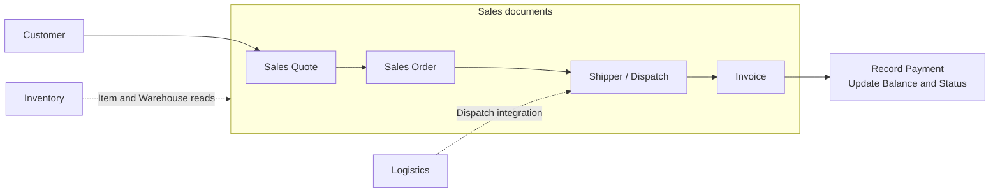

# Sales and Order Entry Design

**Permission decision - 20 November 2026:** Sales and Order Entry uses shared per-user grants. Non-admins have no business access until an admin assigns the corresponding object/operation grant; role labels provide no access. Admins retain all supported, active registered operations within their company. Services authorize before business access or replay. Company isolation, password-change restrictions and business rules still apply. Shipper submission additionally requires Logistics dispatch authorization; its adapter remains pending.

Customer management, sales documents and received amounts

Draft for review | Team 3 | 18 November 2026

- [Introduction](#introduction)
- [Requirements](#requirements)
- [Scope](#scope)
- [Business Requirements](#business-requirements)
- [Action Flow](#action-flow)
- [Design Decisions](#design-decisions)
- [Edge Cases and Validations](#edge-cases-and-validations)
- [Impact on Other Modules](#impact-on-other-modules)

## Introduction

Sales and Order Entry manages Customer information, quotations, sales orders, dispatch confirmation, invoicing and received amounts. Authorized users can prepare sales documents, carry business details forward from a source document and track what each Customer still owes.

**Background:** Inventory owns Item and Warehouse data. Sales reads those references and coordinates dispatch integration responsibilities with Logistics. Orders, Shippers and Invoices may also be created independently.

**Proposed high level solution:** Use the existing PHP/OOP, Oracle and Smarty application. Define and review REST request/response contracts, the business design and database migrations before implementation. Every sales document uses Draft and Submitted states; payments update the outstanding amount and display a payment stamp.

**Assumptions:** Reuse shared login, company isolation, permissions, transactions, revisions, safe retry and audit controls. Exact peer interfaces and dispatch integration are reviewed with the owning teams.

## Requirements

- Maintain Customers, including active status, contact/address details and default Payment Terms.
- Create, read, edit, submit, conditionally return and delete eligible sales documents.
- Support editable standalone lines and full, read-only copying from an optional source.
- Calculate amounts, record received money and show current outstanding balances.
- Protect every action against unauthorized access, partial saves, stale edits and duplicate effects.

## Scope

| Component | Comments |
| --- | --- |
| Technology | PHP/OOP, JavaScript, Oracle and Smarty templates generating HTML. |
| Services and APIs | Customer, Quote, Order, Shipper, Invoice and payment capabilities. Review Swagger first; verify APIs before corresponding UI screens. |
| Database setup | Reviewed migrations create Sales persistence, constraints, indexes, numbering and permissions. Apply only after guide approval. |
| Master data | Sales owns Customers. Inventory owns Item and Warehouse maintenance and supplies read-only active choices. |
| Documents and lines | Draft/Submitted workflow, stable line identities, exact amounts, optional sources and document history. |
| Received amounts | Simple amount entry, outstanding-amount validation, payment stamps and read-only recording history. No gateway or money transfer. |
| Shared foundation | Reuse authentication, company isolation, authorization, transactions, revisions, retry protection and audit. |
| Lists | Customer search/status filters and combined All Documents filters. Printing and a separate reporting subsystem are excluded. |

**Excluded:** approvals, taxes/retainage, discounts, Inventory stock changes, stock allocation, split downstream documents, returns, opening balances, credits and refunds.

## Business Requirements

### Customers and document states

- Customer ID is company-unique, immutable after creation and limited to letters, numbers and hyphens. Deactivate Customers instead of deleting them.
- Generate a numeric record `id` for Customer URLs, separate from the entered business `customer_id`; return both and restrict every lookup to the signed-in company.
- Hide inactive Customers from new selections. Preserve historical references and allow payments against their existing Submitted Invoices.
- Every new document is saved as a numbered Draft before submission. Validate complete business contents on Draft save and submission, except Carrier is required specifically at Shipper submission.
- Submitted business fields are read-only. Return to Draft only when no downstream record references the document; a downstream Draft also blocks return.
- An Invoice with any recorded payment cannot return to Draft. Delete only eligible unreferenced Drafts, using the All Documents list action rather than a form Delete button.
- Generated document numbers are read-only, at most 20 characters and never reused. State changes happen through authorized actions, not editable status fields.

### Optional sources and item lines

- Quotes have no source. Orders may use a Submitted Quote; Shippers a Submitted Order; Invoices a Submitted Shipper. Blank Source permits a standalone document.
- A source must be readable, in the same company, Submitted and unused by another downstream document. One source supplies one full downstream document.
- Saving a linked Draft reserves its source. Copy Customer, Warehouse and all lines; keep inherited values read-only. Deleting that Draft releases its source claim.
- Changing or clearing Source before submission requires confirmation, complete revalidation and atomic release/claim of source links. Returning to Draft retains an existing upstream link.
- Write lines within the parent document as the complete intended collection. New lines receive IDs; existing line IDs must belong to that document. Omission removes a line only on an editable standalone Draft.
- Allow the same Item on distinct lines. Require at least one valid line. Derive every line's Warehouse from the header. Submitted or retained source-linked lines cannot be modified.

### Amounts and document exceptions

| Area | Required behavior |
| --- | --- |
| Calculations | Quantity > 0, up to 9 whole digits and 3 decimals. Unit Price >= 0, up to 10 whole digits and 2 decimals. Round each Quantity x Price half up to 2 decimals, then sum rounded lines. |
| Capacity | Line Amount, Document Total and payment amounts support at most 16 whole digits and 2 decimals. Reject excess precision/capacity; never truncate. |
| Shipper | Require the appropriate Sales permission, Carrier and Logistics dispatch authorization on submission. Submitted confirms dispatch; linked Order remains Submitted. OE makes no stock posting. |
| Invoice | Require positive total on submission. A Draft has no populated payment status or balance contribution. Submission sets Unpaid and contributes outstanding amount once. |
| Invoice return | When eligible, remove its unpaid contribution and clear payment status together. Resubmission contributes once again, without double-counting. |

### Received amount and payment stamp

The user records money already received outside the application. Accept an amount greater than zero and no more than current Amount Due; save the recording and update Total Paid, Amount Due and Customer balance together.

Show **Unpaid** before payment, **Partially Paid** while an amount remains, and **Fully Paid** at zero due. Fully Paid corresponds to Paid in the requirements. The Invoice remains Submitted. Preserve read-only history and prevent duplicate/concurrent overpayment.

## Action Flow

### Flow Diagram

Orders, Shippers and Invoices can also start independently. Dashed arrows show module dependencies.

The main sales journey. Linked documents use an eligible Submitted predecessor; source links are optional.

### End to End Flow

1. Create or select an active Customer. Confirm billing details and default Payment Terms.
2. Choose Quote, Order, Shipper or Invoice. Select active Inventory references for a standalone document, or choose an eligible source and copy its full business details.
3. Save a valid Draft with at least one line. Generate its document number and stable line IDs; reserve a selected source in the same transaction.
4. Edit permitted Draft fields and complete lines. Recalculate amounts. Confirm and atomically validate any source change.
5. Save as Submitted. Require the appropriate Sales permission, Carrier plus Logistics dispatch authorization for a Shipper, and a positive total for an Invoice.
6. For an Invoice, show Unpaid and its Amount Due. Its outstanding amount contributes to the Customer balance.
7. Enter a received amount. Validate against the current outstanding amount and record it once. Update the balance and Partially Paid or Fully Paid stamp.
8. Repeat received-amount entry until due is zero. Retain read-only payment history and block further payments once fully paid.
9. Permit return to Draft or deletion only under the eligibility rules. Any failed action leaves persisted business data unchanged.

**Example:** Submit Invoice 1,000.00 -> receive 300.00 -> outstanding 700.00 and Partially Paid -> reject 800.00 -> receive 700.00 -> outstanding 0.00 and Fully Paid.

## Design Decisions

### Business services and data ownership

REST and Smarty screens use the same Sales services so permissions, calculations and state transitions cannot drift between channels. Sales owns Customers, documents, lines and received-amount recordings. Inventory remains the authority for Item/Warehouse data; OE stores references and business snapshots rather than maintaining a second stock balance.

**Proposed document model:** share headers and lines because all four document types share fields and Draft/Submitted behavior. Keep type-specific rules, source relationships and payments explicit to preserve lineage without duplicating common logic. Guides approve the physical schema separately.

### Complete line collection and source snapshots

Save the complete intended line collection with its parent document. Stable IDs distinguish edits from additions; omission removes an eligible standalone Draft line. This makes header, lines and recalculated amounts one atomic action rather than several independently saved line operations.

Copy and lock inherited values to preserve the agreed transaction. Reserve a source at downstream Draft save, rather than preview, to prevent double use. Replace source links atomically; failure preserves the original Draft and claim.

### Amounts and received money

Use exact decimal arithmetic and round each line half up before summing. This ensures the displayed line amounts add up to the document total. Derive Customer balance from Submitted Invoice dues and payment history, avoiding a second writable balance that could diverge.

Keep document status separate from the payment stamp because receipt does not change Invoice submission. Record received money without a gateway. Immutable recordings and original request identifiers support history and safe retry behind the simple amount-entry screen.

### Consistency and failure handling

Revision checks reject stale edits. Transaction locks serialize source claims and Invoice payments because a revision check alone cannot protect two simultaneous decisions. Re-read current facts after locking; commit business changes, audit and retry results together. Check authorization before replay and resolve an identical committed retry before checking today's revision.

### Assumptions and tradeoffs

- Shared identity, company isolation, transaction and audit foundations are available; OE-specific extensions still need review.
- Full source copying avoids split-quantity tracking. A saved downstream Draft blocks reuse and return of its source until released.
- Read-only payment history preserves accountability; correcting an erroneous recording needs a separately agreed process because update/delete is excluded.
- Use the configured business date and preserve snapshots when master details change. Real peer integration requires agreed contracts, not test doubles.

## Edge Cases and Validations

Validate on the server on save/submission; Carrier is required at Shipper submission. Reject wrong permissions and cross-company access before business effects or replay. Field limits/messages follow the OE requirements.

| Scenario | Design response and reason |
| --- | --- |
| Invalid later line or last line removed | Reject the entire write. Preserve saved lines, totals, state and source claims; a document cannot be partly saved or left empty. |
| Foreign/repeated line ID or changed inherited values | Reject the request. Stable identity must belong to the parent; source-linked values must remain consistent with their source. Repeated Items on distinct lines are allowed. |
| Two users edit a Draft | Require the current revision. The stale user refreshes instead of silently overwriting the other edit. |
| Two targets claim one source | Lock and recheck eligibility with exclusive source usage. One succeeds; the other creates no document or partial claim. |
| Source claim races return to Draft | Serialize on the source and recheck status/usage. A source cannot become editable while a new downstream link succeeds. |
| Invalid amount or rounding overflow | Reject excess precision, negative prices, nonpositive quantities and amounts beyond capacity; never truncate. Line rounding precedes summation. |
| Invoice return after payment | Reject return even for a partial payment. Before payment, an eligible return removes its outstanding contribution once; resubmission restores it once. |
| Payments compete for remaining due | Lock the Invoice and re-read current Amount Due. Reject any payment exceeding that amount; never allow negative due. |
| Timeout or repeated request | Retry unchanged input with the original identifier to retrieve the saved result. Changed input under that identifier conflicts instead of creating another effect. |
| Inactive Customer or unavailable peer | Hide inactive Customers from new selections but allow existing Invoice payments. If required peer validation is unavailable, reject safely rather than assume success. |

### Worked examples for review

**Lines:** 2 x 125.50 plus 1.250 x 10.00 gives 263.50. Changing the first Quantity to 3 gives 389.00; removing the second line gives 376.50. Removing the last line fails.

**Payments:** Invoice 1,000.00; receive 300.00; due 700.00 and Partially Paid. Reject 800.00, then accept 700.00 and show Fully Paid. Retrying either committed request creates no additional recording.

**API-07 contract:** Payment Amount, Payment Date and Payment Reference are required, alongside shared retry/version controls. Keep the recording flow simple; it records money already received outside the application.

## Impact on Other Modules

| Module | Impact | Notes |
| --- | --- | --- |
| Inventory | Medium | Provides active Item/Warehouse references and company visibility. Sales reads and validates these values; it does not change stock or implement Inventory maintenance. |
| Logistics | High | Supplies the agreed dispatch integration for Shipper submission. Its trip planning/delivery design needs reconciliation with the OE document model before integration. |
| Purchasing | Low | No direct Sales posting or table dependency in this scope. Any stock supply remains the responsibility of Purchasing and Inventory. |
| Shared foundation | Medium | Provides login, permissions, tenant boundaries, revisions, transactions, retry and audit conventions. Review any common changes with the foundation owner. |

### Integration alignment required

The Logistics reference assumes allocated order lines, line splits across trips and Order completion after dispatch/delivery. OE instead requires full source copying, Draft/Submitted states and no stock allocation. PM and guides must reconcile these contracts before integration. This design retains Submitted Orders and authorized Shipper submission.

### Review and delivery gates

1. PM approves Swagger behavior and received-amount UI details.
2. Guides approve design, database/migrations and peer contracts.
3. After both approvals, QA creates the test plan; developers apply reviewed migrations and implement APIs.
4. Verify standalone/linked flows, permissions, source races, rounding, payments, retries and rollback before UI acceptance.

**Review decisions:** inactive references after source submission, numbering namespace and Logistics integration responsibilities. API-06 defaults Invoice terms from Customer when Shipper supplies none, permits Draft terms edits and uses 0/15/30 calendar-day Due Date defaults; no Shipper terms field is added.

### Keeping design and implementation aligned

Review behavior changes before coding them, then update this design, Swagger, migrations and affected tests in the same change. Record the decision, reason, reviewer and affected flow so later readers can understand why the system changed. Before sign-off, walk through the worked examples against actual API behavior.

### Reference documents

Order Entry API priorities and stories v6.1, pages 1-13: requirements. Design Docx - Logistics, pages 1-7: structure and presentation. Existing Sales design and confirmed team decisions: design context.
