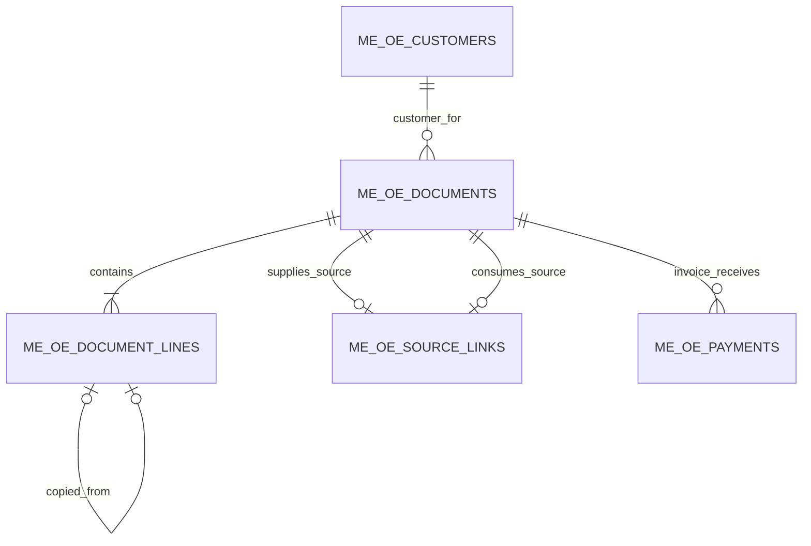
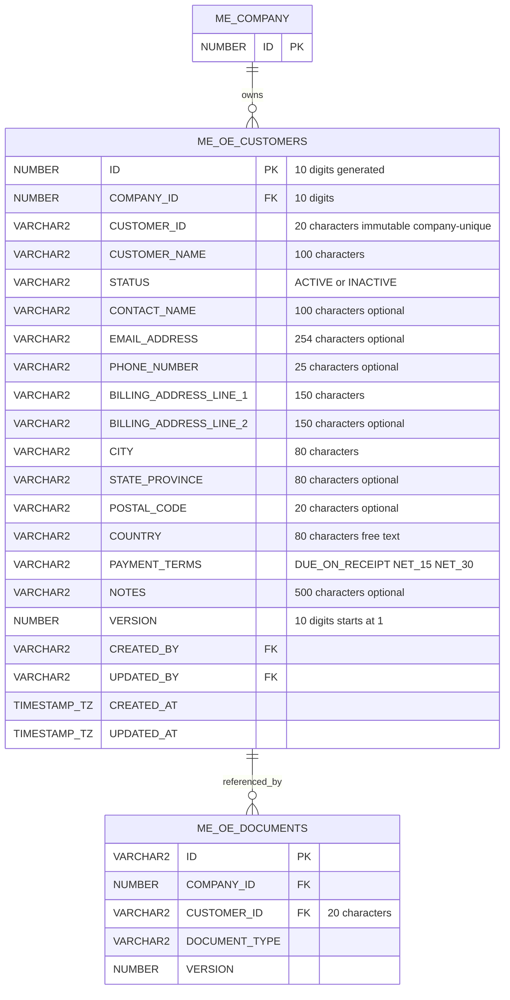
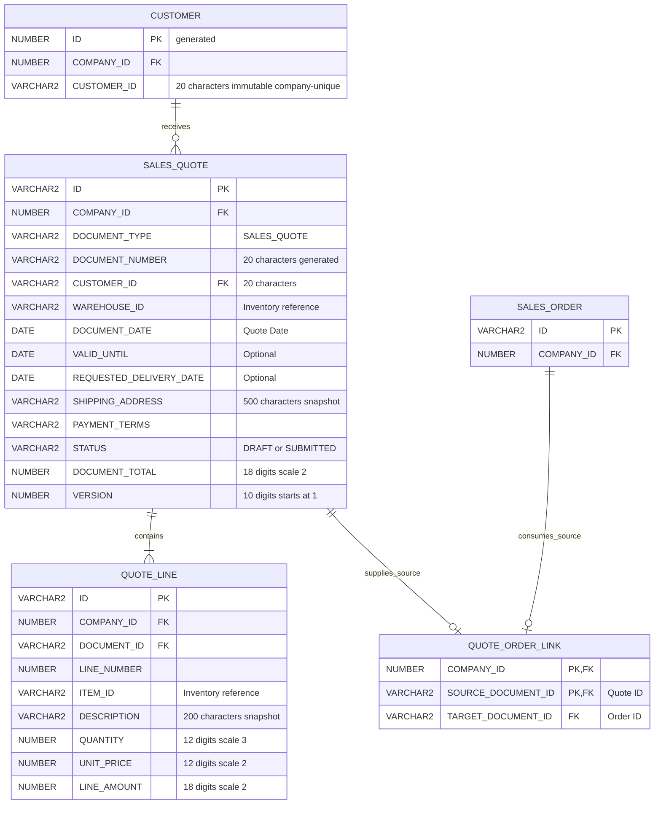
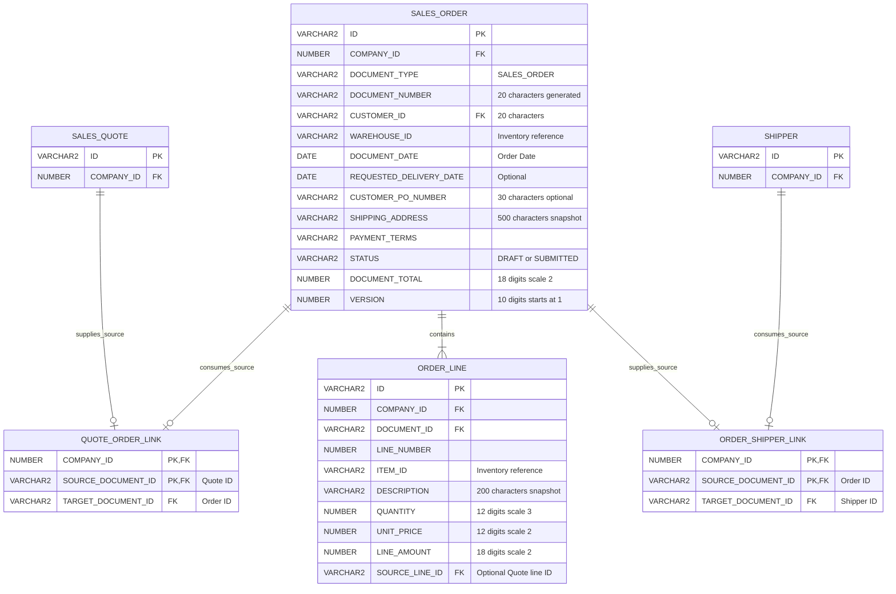
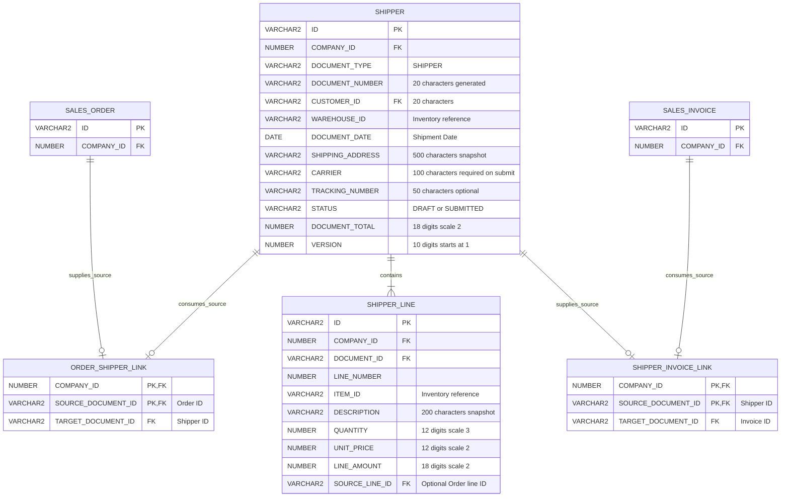
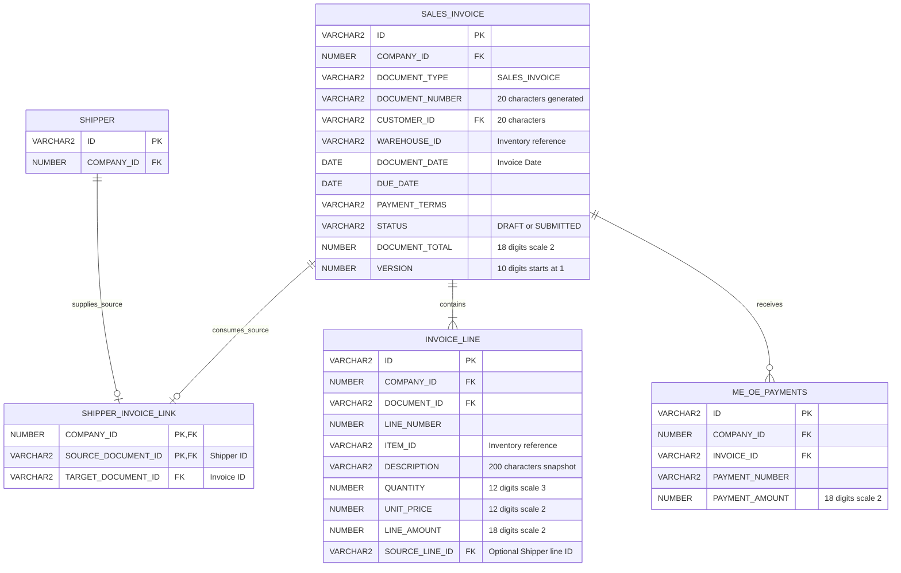
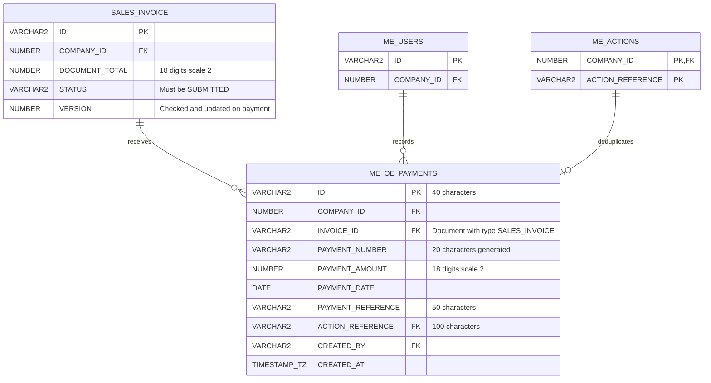

# Sales and Order Entry ER Diagrams

**Status:** Earlier design retained for reference. The [current database design](sales-and-order-entry-db-design.md) supersedes the key names and storage rules below: all Sales tables now use `(CNY#, RECORD#)`, and Customer balance is stored and server maintained. Use its linked Chen diagram for the current fields and relationships.

The diagrams cover Customers, Sales Quotes, Sales Orders, Shippers, Invoices and Payments. They follow the [Sales and Order Entry design](./sales-and-order-entry-design.md): Quotes, Orders, Shippers and Invoices share document headers and lines, with separate source links and received-amount records.

Only the Customer table currently has a draft migration. The remaining structures below are proposals, not deployed tables.

## Table Mapping

| Business area | Physical table | How its records are identified |
| --- | --- | --- |
| Customers | `ME_OE_CUSTOMERS` | Generated numeric ID for URLs; company-unique business Customer ID |
| Sales Quotes | `ME_OE_DOCUMENTS` and `ME_OE_DOCUMENT_LINES` | `DOCUMENT_TYPE = SALES_QUOTE` |
| Sales Orders | `ME_OE_DOCUMENTS` and `ME_OE_DOCUMENT_LINES` | `DOCUMENT_TYPE = SALES_ORDER` |
| Shippers | `ME_OE_DOCUMENTS` and `ME_OE_DOCUMENT_LINES` | `DOCUMENT_TYPE = SHIPPER` |
| Sales Invoices | `ME_OE_DOCUMENTS` and `ME_OE_DOCUMENT_LINES` | `DOCUMENT_TYPE = SALES_INVOICE` |
| Source relationships | `ME_OE_SOURCE_LINKS` | Source and downstream document IDs within a company |
| Payments | `ME_OE_PAYMENTS` | Invoice ID and generated payment number |

In the area diagrams, names such as `SALES_ORDER` and `SALES_ORDER_LINE` are logical views of those shared tables, not additional physical tables. Each diagram shows the fields relevant to that area; common audit fields and some repeated header fields are omitted for readability.

`PK` means primary key; `FK` means foreign key. Required/optional business rules and compound uniqueness are explained below the diagrams. Oracle precisions appear in attribute comments so the Mermaid syntax remains simple.

## Overall Table Relationships

Only Invoice documents receive payments. A source link connects the immediately preceding document type to its downstream document. A standalone document has no incoming source link; a linked document has exactly one. A document can supply at most one downstream document. Quotes cannot consume sources, and Invoices do not supply another sales document in this release.

Each saved document must have at least one line. The service enforces that rule atomically; a simple line foreign key alone cannot guarantee that a header has a line.

## Customers

- This structure matches the current draft Customer migration. `TIMESTAMP_TZ` denotes Oracle `TIMESTAMP WITH TIME ZONE`.
- The primary key is generated numeric `ID`, exposed as read-only `id` and used in Customer URLs such as `/sales/customers/1`. `ME_OE_CUSTOMER_SEQ` supplies its default, starting at 1; gaps are possible. Every lookup also checks the authenticated company.
- User-entered `CUSTOMER_ID`, exposed as `customer_id`, remains immutable and unique under `(COMPANY_ID, CUSTOMER_ID)`. The same business Customer ID may exist in different companies. No `customer_code` column is introduced.
- Proposed document Customer references continue to use `(COMPANY_ID, CUSTOMER_ID)` against the Customer unique constraint; the Customer ID portion is at most 20 characters. Existing document API fields still use this business identifier. Company ID is derived from authentication.
- `CREATED_BY` and `UPDATED_BY` reference existing company users through compound foreign keys, as in the draft migration.
- Deactivate Customers instead of deleting them. Historical references remain intact.
- Do not store an editable Customer balance. Calculate it from Submitted Invoice totals less their recorded payments.

## Sales Quotes

A Quote has no source. An eligible Submitted Quote can supply one Order. A saved Draft Order already occupies that relationship and blocks returning the Quote to Draft. Quotes do not have payment status or payments.

## Sales Orders

**Sales Order version is stored in `ME_OE_DOCUMENTS.VERSION` on the Order row.** It starts at 1 and increments after an accepted change. A write supplies the expected version; the service rejects a stale version and returns the current version on success. Lines use the parent document revision rather than separate writable line versions.

An Order can be standalone or use one Quote. A linked Order receives its own line IDs while preserving source-line references and inherited values. Submission makes it eligible as a Shipper source without allocating stock or creating another status.

## Shippers

A Shipper is standalone or copies one full Submitted Order. Carrier, the appropriate Sales permission and Logistics dispatch authorization are required at submission under the approved API-05 contract. Reuse the agreed Logistics/security provider; no new OE authorization table is proposed, and the real adapter remains pending implementation. A Submitted Shipper confirms dispatch but does not post Inventory stock changes. A linked Invoice, including a Draft, blocks returning its Shipper to Draft.

## Sales Invoices

An Invoice can be standalone or use one full Submitted Shipper. Require a positive total at submission. Only Submitted Invoices contribute to Customer balance and accept payments.

Total Paid, Amount Due and the payment stamp are derived values, not caller-editable columns:

- Total Paid = sum of the Invoice's recorded payments.
- Amount Due = Document Total minus Total Paid.
- Stamp = Unpaid, Partially Paid or Fully Paid; Fully Paid corresponds to the requirements' Paid value.
- Draft Invoices have no populated payment stamp. Recording a payment leaves document status Submitted.

Any payment blocks returning an Invoice to Draft. An eligible unpaid Invoice can return; its balance contribution disappears because it is no longer Submitted.

## Payments

The user enters an amount already received outside the application. Validate it against the current outstanding amount under an Invoice lock, then save the recording, audit, retry result and Invoice revision in one transaction. Payments are append-only and need no separately editable version; concurrent payments are protected by the Invoice's lock and revision.

Payment Number is unique per company. `(COMPANY_ID, ACTION_REFERENCE)` is unique for a payment recording so an identical committed request cannot create another payment. A Payment Reference is business text, not an assumed unique bank transaction ID. No gateway/bank tables are introduced.

The approved API-07 contract requires Payment Date and Payment Reference alongside Payment Amount. The API never accepts caller totals/status, and uses the Invoice revision rather than an editable Payment version.

## Shared Columns and Constraints

### Document headers and lines

All four logical headers map to the same `ME_OE_DOCUMENTS` table. In addition to the relevant fields shown, headers include optional Notes and creation/update actor/timestamps. `VALID_UNTIL`, `REQUESTED_DELIVERY_DATE`, `CUSTOMER_PO_NUMBER`, `SHIPPING_ADDRESS`, `CARRIER`, `TRACKING_NUMBER` and `DUE_DATE` are type-specific fields in that proposed shared table; the service validates which apply. Dates use the configured business date for defaults and comparisons.

All logical line entities map to `ME_OE_DOCUMENT_LINES`. Lines contain nullable `SOURCE_LINE_ID` for copied-line traceability; Quote and standalone lines leave it null. It references a line from the selected source, in the same company. Every line inherits Warehouse from the header rather than storing an independently editable Warehouse. A linked target copies every source line exactly once; source-line and parent-document consistency must be checked in the saving transaction.

| Area | Proposed constraint or control | Reason |
| --- | --- | --- |
| Document identity | Primary key `ID`; unique `(COMPANY_ID, ID)` | Stable identity and company-safe foreign keys |
| Document number | Unique `(COMPANY_ID, DOCUMENT_TYPE, DOCUMENT_NUMBER)`; generated numbers never reused | Business traceability; namespace still requires guide approval |
| Document state | Type-specific discriminator; Status limited to `DRAFT`/`SUBMITTED`; positive `VERSION` | Prevent unsupported states and detect stale updates |
| Document Customer | Compound FK `(COMPANY_ID, CUSTOMER_ID)` to `ME_OE_CUSTOMERS(COMPANY_ID, CUSTOMER_ID)` | Prevent cross-company Customer links |
| Line parent | Primary key `ID`; unique `(COMPANY_ID, ID)`; compound FK to document | Stable line identity and tenant protection |
| Display order | Unique `(COMPANY_ID, DOCUMENT_ID, LINE_NUMBER)` with positive line number | Deterministic saved order |
| Item repetition | No uniqueness constraint on document plus Item | Same Item may appear on distinct lines |
| Numeric storage | Quantity `NUMBER(12,3)`; Unit Price `NUMBER(12,2)`; amounts `NUMBER(18,2)` | Match required precision and capacity |
| Numeric validation | Reject excess precision before persistence; Quantity positive, Unit Price nonnegative | Avoid implicit rounding/truncation hiding invalid input |
| Source claims | PK `(COMPANY_ID, SOURCE_DOCUMENT_ID)`; unique `(COMPANY_ID, TARGET_DOCUMENT_ID)` | At most one target per source and one source per target |
| Source ownership | Both source-link document references use compound company/document foreign keys | No cross-company links |
| Source compatibility | Validate predecessor type, Submitted state, readable access and full copying under lock | A foreign key alone does not enforce workflow eligibility |
| Payment Invoice | Compound FK to document plus service enforcement of Invoice type and Submitted state | No payment against another document type or Draft |
| Payment identity | Unique company/payment number and company/action reference | Identify recordings and prevent duplicate retry effects |
| Audit identity | Actor references use company/user compound keys | Preserve authenticated actor ownership |

Source-link rows are created at downstream Draft save and retained while the source link remains. Clearing/changing Source or deleting an eligible downstream Draft releases the corresponding link atomically; audit retains the relationship history. Source-link records do not represent Inventory stock reservations.

Numeric totals are calculated using exact decimals: round each line half up to 2 decimals, then sum. Source exclusivity and payment not exceeding current due require both persistence constraints and transactional service checks. Revisions alone do not replace locking.

### Existing and external tables

Reuse existing `ME_COMPANY`, `ME_USERS`, permission metadata, `ME_ACTIONS` and `ME_AUDIT`. Their complete schemas are not repeated here. The shared user diagram shows the user ID projection; all actual user references also include Company ID.

`WAREHOUSE_ID` and `ITEM_ID` denote stable Inventory-owned references; business selection codes are not assumed to be their physical IDs. Their exact types, provider table names and integration foreign keys must match Inventory's approved contract. Module-local migrations must not create fake Inventory authorities. Add reviewed cross-module foreign keys only after the real tables exist.

### Review status and next artifacts

- The Customer diagram reflects a draft migration, not evidence that it has been applied.
- Guides must review the other four proposed tables, indexing, numbering, source rules and Invoice-only payment enforcement before migrations are written/applied.
- PM review must settle inactive inherited references. API-07 requires Payment Date and Reference. API-06 uses Customer terms when the Shipper supplies none; no Shipper terms field is added.
- Reconcile Logistics trip/allocation assumptions with the OE full-source, Draft/Submitted workflow before integration.
- Keep the approved database design, Swagger, implementation and tests aligned when decisions change.
